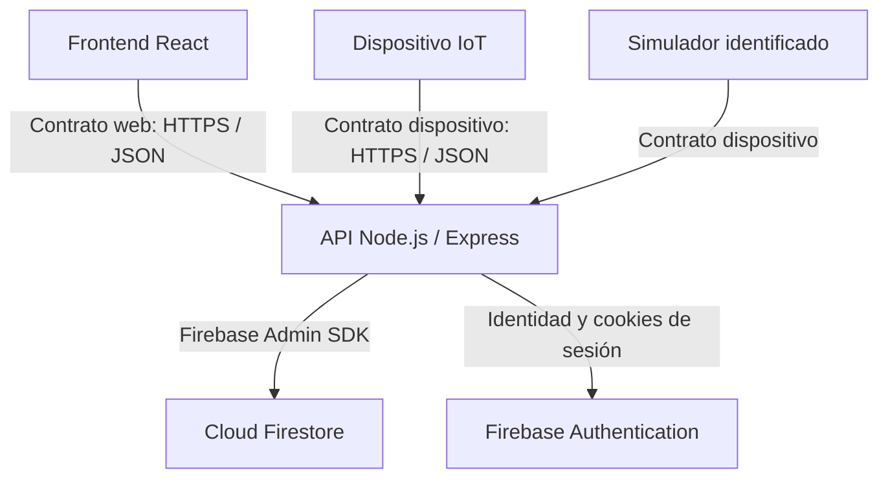

# PulsoLink

**Entrega PL2 de Gerson (en revisión):** [base Firebase reproducible](docs/setup/firebase-pl2.md), [repositorios, interfaces y migración](docs/arquitectura/persistencia-pl2-integracion.md) y [propuesta de dashboard](docs/diseno/dashboard-pacientes-pl2.md). Incluye lecturas HTTP por paciente; los CRUD, el corte del contrato de dispositivo, la nube y la aprobación de diseño conservan los pendientes indicados en esas guías.

> **Alcance aprobado:** [contrato de arquitectura de PulsoLink](docs/arquitectura/contrato-aprobado-2026-10-18.md), [plan de implementación](docs/planificacion/ejecucion-2026-10-18.md) y [modelo objetivo de Firestore](firebase/modelo-objetivo.md). Los OpenAPI 2.0.0 son el contrato objetivo pendiente de implementar; el flujo anterior de `participantCode` y `operator` sigue en el código. La planificación del primer avance que aparece más abajo es antecedente histórico.

## Archivos de referencia para implementar el alcance aprobado

Esta guía aplica a **todo PulsoLink**, no solo al módulo de pacientes. La rama documental entrega las decisiones para su revisión e integración; la fuente de verdad son los archivos aprobados y versionados, no el nombre de la rama. Que una función esté definida en un contrato no significa que ya esté implementada o probada.

### Qué define cada archivo

| Archivo | Autoridad y uso |
| --- | --- |
| [AGENTS.md](AGENTS.md) | Reglas de trabajo, stack, seguridad, secretos y verificación honesta. Leer antes de editar. |
| [Contrato de arquitectura aprobado](docs/arquitectura/contrato-aprobado-2026-10-18.md) | Alcance funcional de todo el proyecto, decisiones cerradas, relaciones paciente–placa–asignación–sesión, permisos y criterios finales. |
| [Contrato A: dispositivo y simulador](contracts/device.openapi.yaml) | Estructura HTTP/JSON de configuración, heartbeat y mediciones; autenticación, campos, unidades, calidad, límites y respuestas. Para preparar el JSON de la placa, partir de `MeasurementInput`. |
| [Contrato B: web y API](contracts/web.openapi.yaml) | Endpoints, cuerpos y respuestas para pacientes, dispositivos, asignaciones, sesiones, usuarios, historial y auditoría; cookies, CSRF y roles. |
| [Modelo objetivo de Firestore](firebase/modelo-objetivo.md) | Colecciones, campos históricos, reservas, transacciones, índices, consulta por paciente y tratamiento del legado. |
| [Plan de ejecución vigente](docs/planificacion/ejecucion-2026-10-18.md) | Paquetes P0–P7, orden y dependencias, migración, diferencias con el código e hitos de aceptación. Las personas mencionadas no equivalen a una nueva reasignación automática. |

El contrato de arquitectura fija las decisiones comunes; los OpenAPI concretan el intercambio HTTP y el modelo de Firestore concreta la persistencia. El plan organiza cómo implementarlos. Leer estas fuentes en conjunto: si discrepan entre sí, coordinar y resolver el cambio mediante PR antes de implementar una interpretación distinta. El código anterior, los ejemplos históricos y las pruebas temporales de conectividad no sustituyen el contrato objetivo.

### Fuentes por fase y módulo

Los identificadores P0–P7 corresponden a los paquetes del plan vigente, no a fechas ni a módulos ya terminados.

| Fase / paquete | Módulos o trabajo | Archivos que rigen la entrega | Resultado a verificar |
| --- | --- | --- | --- |
| **P0 — Acuerdos y entorno** | Contratos compartidos, compatibilidad y preparación | [AGENTS.md](AGENTS.md), [arquitectura aprobada](docs/arquitectura/contrato-aprobado-2026-10-18.md), [plan vigente](docs/planificacion/ejecucion-2026-10-18.md), [OpenAPI A](contracts/device.openapi.yaml) y [B](contracts/web.openapi.yaml) | Acordar campos e interfaces, ventana de migración y entorno Node.js 24 LTS antes de implementar. |
| **P1 — Persistencia** | Pacientes, dispositivos, asignaciones, sesiones, mediciones e historial duradero | [Modelo objetivo de Firestore](firebase/modelo-objetivo.md), [arquitectura aprobada](docs/arquitectura/contrato-aprobado-2026-10-18.md) y DTO del [contrato B](contracts/web.openapi.yaml) | Exclusividad transaccional por paciente/placa, IDs históricos inmutables, deduplicación e historial de un paciente con dos placas. |
| **P2 — API de negocio e ingestión** | Validación de lecturas, CRUD administrativos, asignaciones, sesiones y consultas | [Contrato A](contracts/device.openapi.yaml), [contrato B](contracts/web.openapi.yaml), [modelo de Firestore](firebase/modelo-objetivo.md) y [plan de migración](docs/planificacion/ejecucion-2026-10-18.md) | Contrastar identidad de placa y relaciones activas; implementar permisos, respuestas y conflictos en el servidor existente. |
| **P3 — Autenticación y auditoría** | Acceso, usuarios, roles, sesiones web y logs | [Contrato B](contracts/web.openapi.yaml), [modelo de Firestore](firebase/modelo-objetivo.md) y [arquitectura aprobada](docs/arquitectura/contrato-aprobado-2026-10-18.md) | Migrar `operator → viewer` explícitamente; solo admin administra/consulta auditoría; auditar login y apertura de expediente sin registrar cada refresco. |
| **P4 — CRUD y navegación web** | Pantallas de pacientes, placas, asignaciones y personal | [Contrato B](contracts/web.openapi.yaml), [arquitectura aprobada](docs/arquitectura/contrato-aprobado-2026-10-18.md) y [plan vigente](docs/planificacion/ejecucion-2026-10-18.md) | Formularios y navegación con carga, validación, errores y permisos visibles, conectados a la API. |
| **P5 — Monitoreo e historial web** | Dashboard, calidad, conexión y tendencias por paciente | [Contrato B](contracts/web.openapi.yaml), [arquitectura aprobada](docs/arquitectura/contrato-aprobado-2026-10-18.md) y consulta histórica del [modelo de Firestore](firebase/modelo-objetivo.md) | Distinguir conexión de calidad; representar `null` sin cero, huecos reales y ambos tramos al cambiar de placa. |
| **P6 — Simulador y calidad** | Emisor simulado y pruebas de integración | [Contrato A](contracts/device.openapi.yaml), [contrato B](contracts/web.openapi.yaml) y recorrido de aceptación del [plan vigente](docs/planificacion/ejecucion-2026-10-18.md) | Probar duplicados/conflictos, credenciales, permisos, reasignación, falta de contacto y reconexión sin cola; conservar evidencia reproducible. |
| **P7 — Firmware e integración física** | NodeMCU ESP8266, sensores y comunicación por Wi-Fi | [Contrato A](contracts/device.openapi.yaml), decisiones de dispositivo de la [arquitectura aprobada](docs/arquitectura/contrato-aprobado-2026-10-18.md) y criterios del [plan vigente](docs/planificacion/ejecucion-2026-10-18.md) | Incorporar el sketch integrado, verificar HTTPS y el recorrido real placa → API → web; enviar muestras nuevas y descartar los intervalos sin red. |

**Orden de integración:** P0 → P1 junto con la base de P3 → P2/P3 → P4/P5/P6 → validación integral P6/P7. Los paquetes pueden avanzar en paralelo con interfaces acordadas; completar una pantalla o un esquema no acredita las dependencias ni la demostración final.

### Documentación de apoyo y antecedentes

- [Firebase actual](firebase/README.md), [autenticación actual](docs/auth.md), [firmware](firmware/nodemcu/README.md), [hardware](docs/hardware/README.md) y [simulador](tools/device-simulator/README.md) ayudan a integrar lo existente. Sus firmas o roles anteriores deben migrarse conforme a las fuentes aprobadas.
- [Desarrollo local](docs/setup/desarrollo-local.md) explica la ejecución; [evidencias](docs/evidencias/README.md) y [validación documental](docs/evidencias/contratos-2026-10-18.md) describen lo que se comprobó y sus límites. Una validación OpenAPI no demuestra funcionamiento del sistema.
- El [plan del primer avance](docs/planificacion/avance-2026-10-17.md) y las secciones 2–17 de este README conservan el contexto original. Ante diferencias como `operator`, `participantCode`, fechas del avance o campos del JSON antiguo, usar los archivos vigentes indicados arriba para desarrollar el nuevo alcance.
- Antes de cada tarea, contrastar estos archivos con el checkout, los issues y los PR vigentes. Entregar un PR con comandos y evidencia breve; no marcar un módulo como terminado por estar descrito en esta guía.

**Sistema académico IoT para visualizar y almacenar frecuencia cardíaca, saturación de oxígeno estimada y temperatura superficial mediante una API y una plataforma web.**

- **Repositorio:** https://github.com/codsebas/PulsoLink
- **Inicio de planificación:** 16 de octubre de 2026.
- **Primer avance:** sábado 17 de octubre de 2026, horario de Guatemala.
- **Estado observado al 19 de octubre de 2026:** autenticación, ingestión, persistencia y rutas de sesiones/dispositivos del contrato anterior están implementadas en `main`. Pacientes, asignaciones, historial por paciente, rol `viewer` y auditoría del nuevo alcance siguen pendientes. Las secciones de planificación inferiores describen el primer avance, no el estado actual de la nueva arquitectura.
- **Responsable del dispositivo y coordinación técnica:** `@codsebas`.
- **Base de datos acordada:** Cloud Firestore, de Firebase.

El bloque AV1-04 de `@gioore` incluye repositorios, transacciones de sesiones/ingestión, aprovisionamiento repetible y configuración de índices. Consulte [firmas de integración y comandos de verificación](firebase/README.md) y [evidencia de ejecución](docs/evidencias/firestore-av1-04.md).

## 1. Propósito

Construir un prototipo que reciba mediciones de un dispositivo conectado por Wi-Fi, las valide en un backend, las almacene en Firebase y permita consultarlas desde una aplicación web.

El proyecto separa el desarrollo del dispositivo del desarrollo web mediante contratos de API. Durante la primera entrega, un simulador enviará datos al mismo endpoint que usará el dispositivo. La interfaz identificará siempre las mediciones simuladas.

Las lecturas son de carácter académico: la temperatura corresponde a la superficie del dedo; la SpO₂ es una estimación que requiere validación del montaje y del algoritmo. No se presentan diagnósticos médicos.

## 2. Alcance del avance del 17 de octubre

### Objetivo demostrable

**Iniciar sesión → crear una sesión de medición → iniciarla → recibir datos del simulador → ver indicadores y tendencias → finalizar → consultar el historial persistido.**

| Funcionalidad | Criterio de aceptación |
| --- | --- |
| Acceso | Un usuario de demostración puede iniciar y cerrar sesión mediante la API. |
| Roles | Existen administrador y operador; los permisos se validan en el backend. |
| Dispositivos | Se muestra código, origen real/simulado y última comunicación. |
| Sesiones | Se pueden crear, iniciar y finalizar; un dispositivo no admite dos sesiones activas. |
| Dashboard | Muestra pulso, SpO₂ estimada y temperatura superficial con unidades. |
| Actualización | Consulta novedades cada 2 segundos mientras la sesión está activa y la página visible. |
| Tendencias | Grafica valores recibidos a lo largo del tiempo, separados por magnitud y unidad. |
| Historial | Permite consultar mediciones de una sesión con paginación. |
| Simulación | El simulador usa credencial propia y la misma API del dispositivo. |
| Persistencia | Al recargar el navegador siguen disponibles las mediciones guardadas. |
| Estados | Distingue carga, error, ausencia de datos, falta de contacto y datos desactualizados. |
| Documentación | Explica cómo configurar, ejecutar y demostrar lo que realmente esté implementado. |

La primera entrega no depende de tener conectado el hardware. Los datos simulados se guardarán en Cloud Firestore para la demostración integrada; los emuladores podrán utilizarse durante desarrollo, indicando expresamente cuando la evidencia corresponda a ellos.

### Fuera de este primer avance

Presión arterial, onda óptica PPG de alta frecuencia, diagnósticos o alertas clínicas, análisis con IA, exportación PDF, registro público, recuperación de contraseña e interfaz completa de administración de usuarios.

Estos elementos no se consideran implementados ni comprometidos para mañana. Las tendencias del dashboard no se deben presentar como una onda PPG o un electrocardiograma.

## 3. Stack acordado

| Área | Tecnología | Uso |
| --- | --- | --- |
| Frontend | React + TypeScript + Vite | Aplicación web de una sola página |
| Diseño | Tailwind CSS | Interfaz adaptable a escritorio y móvil |
| Navegación | React Router | Rutas de acceso, dispositivos, sesiones e historial |
| Estado remoto | TanStack Query | Consultas, invalidación, errores y actualización periódica |
| Gráficas | Recharts | Tendencias de cada magnitud |
| Backend | Node.js 24 LTS + Express 5 + TypeScript | API REST y reglas de negocio |
| Validación | Zod | Validación en tiempo de ejecución |
| Base de datos | Cloud Firestore, edición Standard | Documentos de usuarios, dispositivos, sesiones y mediciones |
| Identidad | Firebase Authentication, correo y contraseña | Verificación de credenciales, integrada detrás de nuestra API |
| Acceso del servidor | Firebase Admin SDK | Acceso a Firestore y verificación de sesiones |
| Contratos | OpenAPI 3.1 + Swagger UI | Dos especificaciones que se implementarán después del README |
| Pruebas | Vitest + Supertest | Servicios y endpoints críticos |
| Organización | npm workspaces + Git + GitHub | Un repositorio para el equipo |

Las versiones exactas compatibles y `package-lock.json` se fijarán al crear el proyecto ejecutable. No ejecutar instrucciones de instalación de dependencias como si ya existiera un `package.json`.

**Cloud Firestore reemplaza la propuesta anterior de PostgreSQL y Prisma.** Se utilizarán colecciones y documentos, sin un segundo almacén SQL. Firebase dispone también de SQL Connect sobre PostgreSQL, pero ese servicio no forma parte de esta versión.

La elección de Firebase como base de datos no obliga a acceder a ella desde el navegador. Tanto la web como el dispositivo usarán nuestra API.

## 4. Arquitectura y patrones



### Frontend

Organización por funcionalidades: `auth`, `devices`, `sessions`, `monitoring` e `history`.

Cada funcionalidad separa componentes visuales, hooks y funciones de acceso a la API. Un cliente HTTP común gestiona credenciales, CSRF, errores y URL base. TanStack Query gestiona los datos remotos; el estado local de formularios permanece en React. No se introduce Redux inicialmente.

### Backend

Monolito modular organizado por funcionalidades, con capas:

1. **Rutas y middleware:** autenticación, autorización, límites y validación.
2. **Controladores:** traducción de HTTP a entradas del servicio y respuestas HTTP.
3. **Servicios:** reglas de negocio y coordinación de operaciones.
4. **Repositorios:** acceso a Firestore a través de Firebase Admin SDK.

Los controladores no contienen consultas a Firestore. Los repositorios permiten probar los servicios con implementaciones controladas, sin crear una abstracción genérica innecesaria.

### Acceso y despliegue

- Web y API tendrán el mismo origen público; en desarrollo, Vite redirigirá `/api` al backend.
- El backend podrá servir los archivos compilados de la web en el despliegue inicial.
- El proveedor de alojamiento y la URL pública están pendientes de elección. No se presupone un plan gratuito ni una cuenta de facturación configurada.
- El dispositivo necesitará acceso a la URL HTTPS del backend. `localhost` desde el dispositivo no apunta a la computadora del desarrollador.
- Firebase Admin SDK evita las reglas de seguridad de Firestore: la API debe aplicar permisos y validaciones, y el servidor debe tener IAM adecuado.
- Se denegará el acceso directo de clientes a Firestore. Las credenciales administrativas se mantendrán exclusivamente en el servidor.

## 5. Roles de la aplicación

Los roles de la aplicación son independientes de los permisos como colaborador en GitHub.

| Operación | Administrador | Operador |
| --- | --- | --- |
| Consultar dispositivos habilitados | Sí | Sí |
| Crear e iniciar una sesión propia | Sí | Sí |
| Consultar y finalizar sesiones propias | Sí | Sí |
| Consultar y finalizar sesiones ajenas | Sí | No |
| Aprovisionar usuarios y dispositivos | Sí, inicialmente mediante scripts | No |

Para el avance se aprovisionarán cuentas de prueba mediante un script administrativo. No se almacenarán contraseñas en documentos de Firestore; Firebase Authentication gestionará las credenciales.

Se utilizará un código de participante como `P-001`, sin requerir nombres, DPI ni expedientes clínicos.

## 6. Modelo de datos propuesto

| Ruta de Firestore | Contenido principal |
| --- | --- |
| `users/{uid}` | Nombre visible, rol, estado habilitado y fecha de creación; identidad vinculada a Firebase Auth |
| `devices/{deviceId}` | Código, placa, origen `real/simulated`, estado habilitado, `activeSessionId` y `lastSeenAt` |
| `deviceCredentials/{credentialId}` | Dispositivo asociado, hash del secreto, estado y fechas; solo servidor |
| `sessions/{sessionId}` | Código de participante, operador propietario, dispositivo, estado, origen, fechas y última medición |
| `sessions/{sessionId}/measurements/{measurementId}` | Valores y calidad de cada magnitud, secuencia y marcas de tiempo |
| `ingestionKeys/{keyHash}` | Referencia y hash del contenido para idempotencia por dispositivo, arranque y secuencia |

Reglas:

- Estados de sesión: `created`, `active`, `finished`. No se reabre una sesión finalizada en esta versión.
- La reserva del dispositivo y el inicio de sesión se realizarán en una transacción.
- Finalizar una sesión libera el dispositivo en una transacción.
- La recepción de una medición comprueba la sesión activa y escribe medición, clave de idempotencia y resumen de última lectura de forma atómica.
- No guardar todo el historial en un array dentro de un documento.
- El origen de una sesión se fija a partir del dispositivo y no cambia durante ella.
- El operador propietario procede del usuario autenticado, nunca de un campo elegido por el navegador.
- `receivedAt` y fechas administrativas las asigna el servidor; `capturedAt` es opcional y procede del dispositivo.
- Los índices necesarios se versionarán con el código. Como mínimo, se considerarán listados por propietario/fecha y estado/fecha; se validarán contra las consultas implementadas.
- Los DTO de la API son independientes del formato interno de Firestore.

## 7. Convenciones compartidas de API

Los siguientes contratos son la **base documental v1**. Los archivos OpenAPI aún no existen en este commit; deberán reproducir estas decisiones antes de la integración.

- Prefijo: `/api/v1`.
- HTTPS fuera del desarrollo local.
- JSON con `Content-Type: application/json`.
- IDs como cadenas opacas; no asumir que contienen un número consecutivo.
- Fechas ISO 8601 en UTC; la web presenta la hora de `America/Guatemala`.
- Valores ausentes o inválidos: `null`, nunca cero inventado.
- Respuesta individual: `{ "data": ... }`.
- Lista: `{ "data": [], "pagination": { "nextCursor": null, "hasMore": false } }`.
- Paginación por cursor opaco: `limit` entre 1 y 100, predeterminado 50. El cursor se valida y queda ligado al filtro y al orden.
- Las rutas de dispositivo aceptan exclusivamente credenciales de dispositivo; las rutas web exigen autenticación de usuario.
- No se devuelve el secreto del dispositivo, su hash ni credenciales de Firebase.
- Límite inicial del cuerpo de mediciones: 8 KiB. Se definirán límites de solicitudes que permitan reintentos razonables.

Formato de error:

```json
{
  "error": {
    "code": "SESSION_NOT_ACTIVE",
    "message": "La sesión no está activa.",
    "requestId": "req-001"
  }
}
```

| HTTP | Uso |
| --- | --- |
| 400 | JSON, campos, filtros o cursor inválidos |
| 401 | Credencial ausente, inválida o vencida |
| 403 | Usuario sin permiso o dispositivo deshabilitado |
| 404 | Recurso inexistente o no visible para ese usuario |
| 409 | Dispositivo ocupado, estado de sesión incompatible o conflicto de idempotencia |
| 413 | Cuerpo demasiado grande |
| 429 | Exceso de solicitudes; respetar `Retry-After` |
| 500 / 503 | Error interno o dependencia no disponible; no exponer detalles sensibles |

## 8. Contrato A: dispositivo y simulador ↔ backend

### Autenticación

Cabecera `Authorization: Bearer <credentialId>.<secret>`. Se generará un secreto aleatorio de alta entropía; el servidor conservará su hash y lo comparará de forma segura.

La identidad y el origen del dispositivo se obtienen de la credencial. No se aceptan `deviceId` o `source` enviados en el cuerpo para cambiar esa identidad.

| Método y ruta | Entrada | Salida |
| --- | --- | --- |
| `GET /api/v1/device/config` | Sin cuerpo | 200: dispositivo, sesión activa e intervalos |
| `POST /api/v1/device/heartbeat` | `bootId`, `uptimeMs`, `firmwareVersion` opcional | 200: hora del servidor |
| `POST /api/v1/device/measurements` | Medición completa descrita abajo | 201 nueva; 200 reintento idéntico |

Configuración:

```json
{
  "data": {
    "deviceId": "dev-001",
    "activeSessionId": "ses-001",
    "uploadIntervalMs": 2000,
    "heartbeatIntervalMs": 15000,
    "configPollIntervalMs": 5000,
    "serverTime": "2026-10-17T16:30:00Z"
  }
}
```

Con `activeSessionId: null`, el emisor consulta configuración e informa presencia; no almacena lecturas de participantes. Se consulta configuración también después de un conflicto de sesión.

Medición:

```json
{
  "sessionId": "ses-001",
  "bootId": "1d97d825-f680-4f18-b48c-9d2467c0d60b",
  "sequence": 42,
  "capturedAt": "2026-10-17T16:30:00Z",
  "measurements": {
    "heartRate": { "value": 78, "unit": "bpm", "status": "valid" },
    "spo2": { "value": 97, "unit": "%", "status": "valid" },
    "skinTemperature": { "value": 33.4, "unit": "C", "status": "valid" }
  }
}
```

| Campo | Regla |
| --- | --- |
| `sessionId` | Debe coincidir con la sesión activa asignada al dispositivo |
| `bootId` | UUID generado una vez por arranque |
| `sequence` | Entero no negativo, creciente dentro de ese arranque; máximo 2³²−1 |
| `capturedAt` | Fecha UTC o `null` si no hay reloj sincronizado |
| `measurements` | Siempre contiene las tres magnitudes; cada una tiene valor, unidad y estado |
| `status` | `valid`, `no_contact`, `invalid` o `unavailable` |
| `value` | Número finito si es `valid`; `null` en los demás estados |
| Unidades | Exactamente `bpm`, `%` y `C`, respectivamente |

Validación técnica inicial para valores marcados como válidos: pulso mayor que 0 y hasta 300 bpm; SpO₂ entre 0 y 100 %; temperatura entre −55 y 125 °C. Son límites de entrada del prototipo, no rangos de normalidad médica ni garantías de desempeño del montaje.

Cada magnitud tiene calidad independiente. Sin lectura óptica, pulso y SpO₂ pueden ser `null` mientras la temperatura continúa disponible. No se inferirá contacto del DS18B20 si el hardware no lo permite.

Respuesta:

```json
{
  "data": {
    "measurementId": "med-001",
    "receivedAt": "2026-10-17T16:30:01Z",
    "duplicate": false
  }
}
```

### Reintentos y orden

- Clave única: dispositivo autenticado + `bootId` + `sequence`.
- Un reintento conserva exactamente la misma clave y contenido.
- Se compara el contenido validado y normalizado, no el orden textual de propiedades JSON.
- Si ya existe una medición idéntica, se devuelve 200 con la referencia original y `duplicate: true`, incluso si la sesión acaba de finalizar.
- Misma clave con distinto contenido: 409 `IDEMPOTENCY_CONFLICT`.
- Una medición nueva para una sesión finalizada: 409 `SESSION_NOT_ACTIVE`.
- Para este avance el emisor serializa sus envíos y no reproduce un historial acumulado durante una desconexión. Tras agotar reintentos limitados, descarta esa muestra y continúa con una nueva.
- La última lectura se define por orden de recepción del servidor. No se pretende reconstruir muestreo histórico fuera de línea.
- Reintentar fallos de red, 429 y 5xx con espera exponencial limitada; no repetir indefinidamente errores 400/401/403.
- Enviar cada 2 segundos no equivale a muestrear el MAX30102 cada 2 segundos: el firmware procesa las muestras ópticas por separado.

## 9. Contrato B: frontend ↔ backend

### Acceso

El navegador utilizará únicamente nuestra API para los flujos de esta versión.

1. Obtiene un token CSRF en `GET /api/v1/auth/csrf`.
2. Envía correo y contraseña a `POST /api/v1/auth/login` con `X-CSRF-Token`.
3. El backend verifica las credenciales con Firebase Auth REST y crea una cookie de sesión mediante Admin SDK. No registra contraseñas ni devuelve tokens de Firebase al navegador.
4. La cookie `pulsolink_session` será `HttpOnly`, `SameSite=Lax`, `Path=/` y `Secure` en HTTPS, con duración inicial de 8 horas. La excepción de HTTP se limita al desarrollo local.
5. La API comprueba la cookie, revocación, usuario habilitado y rol antes de autorizar.
6. Las mutaciones web, incluido login/logout, exigen comprobación de origen y token CSRF ligado al contexto del navegador. El token se renueva tras iniciar/cerrar sesión.
7. Logout elimina la cookie del navegador; la revocación global de sesiones se reserva para una acción administrativa. El frontend borra su caché de datos al salir.

No almacenar sesiones en `localStorage`. Las cuentas y roles se aprovisionan mediante un script administrativo; no se aceptará un rol enviado por el formulario de login.

| Método y ruta | Función / respuesta |
| --- | --- |
| `GET /api/v1/auth/csrf` | 200: `data.csrfToken`; no requiere login |
| `POST /api/v1/auth/login` | Cuerpo `{email,password}`; 200: usuario y cookie |
| `POST /api/v1/auth/logout` | 204, sin cuerpo; elimina cookie |
| `GET /api/v1/auth/me` | 200: `{data:{id,displayName,role}}` |
| `GET /api/v1/devices` | 200: lista paginada de dispositivos habilitados sin secretos |
| `POST /api/v1/sessions` | Cuerpo `{participantCode,deviceId}`; 201: sesión `created` |
| `POST /api/v1/sessions/{id}/start` | Sin cuerpo; 200: sesión `active`; 409 si dispositivo ocupado |
| `POST /api/v1/sessions/{id}/finish` | Sin cuerpo; 200: sesión `finished` |
| `GET /api/v1/sessions` | Lista paginada; filtros `status`, `deviceId`, `from`, `to` |
| `GET /api/v1/sessions/{id}` | 200: detalles autorizados |
| `GET /api/v1/sessions/{id}/latest` | 200: última lectura o ausencia de datos |
| `GET /api/v1/sessions/{id}/measurements` | Historial con `from`, `to`, `cursor`, `limit` |

El código del participante tendrá de 1 a 32 caracteres y solo letras, números, guion y guion bajo. La API asigna el propietario de la sesión a partir del usuario autenticado.

Modelo de sesión en respuestas:

```json
{
  "data": {
    "id": "ses-001",
    "participantCode": "P-001",
    "operatorId": "usr-001",
    "deviceId": "dev-001",
    "source": "simulated",
    "status": "created",
    "createdAt": "2026-10-17T16:29:00Z",
    "startedAt": null,
    "finishedAt": null
  }
}
```

Repetir `start` sobre la misma sesión activa devuelve su estado sin reiniciarla. Repetir `finish` sobre una finalizada devuelve su estado sin modificar fechas. Finalizar una sesión que nunca se inició produce 409.

El operador solo consulta y modifica sus sesiones; el administrador puede acceder a todas. La API aplicará ese filtro también a consultas de historial, no solo a la pantalla principal.

### Lecturas, estados y paginación

`latest` devolverá `data: null` cuando no existan muestras. Siempre incluirá un objeto `meta` con `serverTime`, `lastSeenAt`, `deviceOnline`, `ageMs` y `stale`.

- `deviceOnline`: última comunicación hace 45 segundos o menos.
- `ageMs`: antigüedad de la última muestra según `receivedAt`; `null` si no existe.
- `stale`: `true` sin muestras o con antigüedad mayor a 10 segundos.
- Dispositivo conectado no significa dedo colocado ni señal válida.
- En sesiones finalizadas se muestran valores históricos con sus fechas, sin presentarlos como medición en vivo.

Cada medición de salida contiene `id`, `sessionId`, `deviceId`, `source`, `bootId`, `sequence`, `capturedAt`, `receivedAt` y `measurements` con los mismos nombres y unidades del contrato A.

Los listados de sesiones se ordenan por `createdAt` descendente y luego ID. Los de mediciones, por `receivedAt` descendente y luego ID. Los filtros temporales usan esos campos respectivamente: `from` inclusivo y `to` exclusivo. La gráfica reordena las muestras cronológicamente y deduplica por ID.

La actualización del dashboard usa `latest`; el historial/gráfica mantiene una ventana acotada de hasta 100 muestras. No descarga todo el historial cada 2 segundos. Pausa las consultas periódicas al salir de la pantalla o finalizar la sesión.

## 10. Equipo y asignaciones propuestas

Las asignaciones son una propuesta de coordinación para el primer avance; todavía no se han creado issues ni asignaciones en GitHub. La presencia de una cuenta en una captura de invitaciones no implica aceptación ni disponibilidad confirmada.

| Cuenta | Bloque | Entregable y coordinación |
| --- | --- | --- |
| `@codsebas` | Dispositivo y coordinación técnica | Firmware/lecturas/envío según contrato A. Coordina el contrato con backend, sin asumir tareas de implementación web. |
| `@AxelHerrera11` | Estructura frontend | Configuración de React, navegación, layout y componentes compartidos. Coordina con todas las pantallas. |
| `@DidhyerOrtiz` / `@DidhyerOrtizG` | API de dispositivos y sesiones | Configuración de Express, recepción, validación y ciclo de sesiones. Coordina con persistencia, firmware y el responsable del simulador. |
| `@gioore` | Firebase y persistencia | Modelo, repositorios, transacciones, índices y configuración de Firestore; datos de demostración junto con acceso. |
| `@Javifa2324` | Monitoreo | Dashboard, indicadores, tendencias, actualización y estados de calidad. |
| `@Lis671` | Sesiones e historial frontend | Dispositivos, creación/inicio/fin de sesiones, filtros y paginación. |
| `@Mar-03` | Autenticación y autorización | Flujo de acceso frontend/API, Firebase Auth, cookies, CSRF, roles y usuarios de prueba. |
| `@orem6` | Integración, calidad y demostración | Revisión cruzada de contratos, pruebas del recorrido, comandos reproducibles, evidencias y preparación del despliegue. |
| `@HugoX2024` | Simulador IoT y escenarios de prueba | Implementación de `tools/device-simulator/` según contrato A, con configuración, heartbeat, envío periódico, reintentos y escenarios sin señal. Coordina con backend y con `@orem6` para la demostración. |

**Pendiente:** confirmar si `DidhyerOrtiz` y `DidhyerOrtizG` corresponden a una misma persona y cuál es la cuenta principal. Hasta resolverlo se consideran un único bloque, no dos integrantes distintos.

### Entregable de HugoX2024 para el 17 de octubre

Desarrollar un simulador en Node.js y TypeScript que permita al equipo web trabajar sin el dispositivo físico. Esta asignación se transfiere del bloque de API al nuevo integrante; el firmware real continúa a cargo de `@codsebas`.

- Configurar URL de la API y credencial de un dispositivo de origen `simulated` mediante variables de entorno, sin incluir secretos en Git.
- Consultar `/api/v1/device/config`, respetar la sesión activa y enviar heartbeat con los intervalos del contrato A.
- Enviar las tres magnitudes cada 2 segundos cuando exista una sesión activa, con `bootId`, `sequence`, fecha y calidad por magnitud.
- Incluir escenarios seleccionables de lectura válida, falta de contacto óptico, sensor no disponible y desconexión. Para simular desconexión se suspenden mediciones y heartbeat; para falta de contacto se conserva la comunicación y se envían valores ópticos nulos con `no_contact`.
- Permitir repetir una petición idéntica para comprobar que no duplica el historial y otra con igual clave pero distinto contenido para comprobar el error 409. Estos escenarios de prueba son explícitos y no alteran el comportamiento normal del emisor.
- Respetar los reintentos limitados, serialización y tratamiento de errores descritos en el contrato A; detener el envío de muestras cuando no haya sesión activa.
- Documentar comandos de ejecución, variables y escenarios. Entregar a `@orem6` el recorrido reproducible y coordinar los resultados esperados con el responsable de backend.

**Aceptación:** el simulador hace aparecer datos identificados como simulados en el dashboard y en el historial persistido; permite demostrar falta de contacto, datos desactualizados y ausencia de duplicados. Su implementación no requiere acceso directo a Firestore ni a credenciales administrativas de Firebase.

### Secuencia de trabajo

1. **Base compartida:** frontend, backend, configuración e interfaces de repositorios; materializar ambos contratos OpenAPI.
2. **Trabajo concurrente:** acceso, persistencia, endpoints, pantallas y simulador utilizando ejemplos acordados.
3. **Integración:** la web consume la API real; la API persiste en Firestore; el simulador entra por contrato A.
4. **Demostración:** ejecutar el recorrido completo, comprobar permisos, reintentos y estados sin señal.
5. **Revisión final:** actualizar el README con comandos reales, limitaciones observadas y enlaces de evidencia.

Los mocks sirven durante el desarrollo aislado. La demostración integrada no se considerará terminada si las pantallas solo muestran valores fijos o datos locales sin pasar por la API.

## 11. Organización futura del repositorio

En este commit solo existe `README.md`. Esta tabla describe carpetas **por crear**:

| Ruta | Responsabilidad |
| --- | --- |
| `apps/web/` | Frontend |
| `apps/api/` | API, servicios y repositorios |
| `tools/device-simulator/` | Simulador con credencial independiente |
| `contracts/device.openapi.yaml` | Contrato A |
| `contracts/web.openapi.yaml` | Contrato B |
| `contracts/schemas/` | Definiciones comunes de medición y error |
| `firebase/` | Reglas, índices y configuración versionable |
| `firmware/` | Código del dispositivo |
| `docs/` | Arquitectura, guía de demostración y decisiones |
| `.github/workflows/` | Comprobaciones de integración continua |

## 12. Flujo de colaboración

- Rama estable: `main`.
- Este primer commit documental se publica directamente en `main` por acuerdo del coordinador.
- Desarrollo posterior en ramas cortas: `feat/auth`, `feat/device-api`, `feat/firestore`, `feat/dashboard`, etc.
- Integración mediante pull request con revisión de otro integrante; esta es una regla del equipo, no una protección de rama ya configurada.
- Cada PR explica cambio, verificación y pendientes. No mezclar cambios ajenos a la tarea.
- Coordinar modificaciones de contratos antes de cambiar implementaciones.
- No editar simultáneamente archivos centrales sin acordarlo con el responsable; quien integra resuelve los cambios de dependencias y lockfile.
- El coordinador participa cuando hay cambios en el contrato del dispositivo, frecuencia de envío o tratamiento de errores.
- Issues y asignaciones formales se abrirán en una etapa posterior.
- No subir `.env`, cuentas de servicio, contraseñas, tokens, datos Wi-Fi ni datos personales reales. Los ejemplos solo contienen marcadores.
- Antes del primer commit de código se incorporarán `.gitignore`, `.env.example` y comandos de comprobación.

## 13. Obtener el repositorio en Windows

Ruta solicitada por el coordinador:

```text
C:\Users\sebas\UMG\Octavo Ciclo\Desarrollo Web\Proyecto-Final
```

Desde PowerShell, si la carpeta de destino no existe o está vacía:

```powershell
New-Item -ItemType Directory -Force -Path "C:\Users\sebas\UMG\Octavo Ciclo\Desarrollo Web" | Out-Null
git clone https://github.com/codsebas/PulsoLink.git "C:\Users\sebas\UMG\Octavo Ciclo\Desarrollo Web\Proyecto-Final"
Set-Location "C:\Users\sebas\UMG\Octavo Ciclo\Desarrollo Web\Proyecto-Final"
git status
```

Si la carpeta contiene archivos, revisarlos antes de clonar; no eliminarlos ni sobrescribirlos. Si ya es el clon de este repositorio, comprobar `git remote -v` y el estado de los cambios antes de actualizarlo.

Estos comandos se ejecutan en la computadora del coordinador. Publicar este README en GitHub no crea automáticamente esa carpeta local.

## 14. Configuración y verificación pendientes

Antes de implementar:

- Crear o seleccionar el proyecto de Firebase y su base Cloud Firestore Standard.
- Elegir región y comprobar cuotas y facturación aplicables antes de activar recursos con coste.
- Habilitar el proveedor correo/contraseña de Firebase Authentication.
- Configurar credenciales del backend mediante el mecanismo seguro del entorno.
- Provisionar usuarios administrador/operador y un dispositivo de origen `simulated`.
- Definir URL del frontend, puerto de API, proyecto Firebase y credenciales de demostración mediante variables de entorno.
- Generar contratos OpenAPI, configuración local y scripts reproducibles.
- Mantener separados datos/credenciales reales y simulados.

Criterios de verificación para la entrega:

- [ ] Login, logout y consulta de usuario funcionan.
- [ ] Un operador no puede leer o modificar sesiones ajenas cambiando la URL.
- [ ] Solo se puede activar una sesión por dispositivo, incluso con solicitudes simultáneas.
- [ ] El simulador autentica y envía mediciones por la API.
- [ ] Un reintento idéntico no duplica el historial; uno conflictivo devuelve 409.
- [ ] Los valores con estado inválido se representan como ausentes.
- [ ] La desconexión y la falta de contacto se distinguen.
- [ ] Finalizar impide nuevas muestras y libera el dispositivo.
- [ ] Las mediciones siguen disponibles tras recargar la página.
- [ ] Las pruebas integradas utilizan Firestore y registran si es emulador o servicio en la nube.
- [ ] La compilación y la comprobación de tipos pasan.
- [ ] El README incluye los comandos reales una vez que existan.
- [ ] La demostración indica explícitamente que utiliza datos simulados.

Esta lista está pendiente: no representa pruebas ya ejecutadas.

## 15. Hardware y decisiones abiertas

La descripción actual del repositorio identifica **NodeMCU ESP8266, MAX30102 y DS18B20 TO-92**. Durante la coordinación también se mencionaron ESP32 y Raspberry. Se conserva esa discrepancia como pendiente de confirmar antes de escoger plataforma y librerías de firmware.

El contrato A permanece independiente de la placa. Si se cambia de microcontrolador a Raspberry Pi, deberán revisarse implementación, alimentación y montaje; no se asume equivalencia de hardware.

Otros pendientes: cuenta principal de Didhyer, aceptación de invitaciones, confirmación de asignaciones, proyecto Firebase, alojamiento y URL del backend. No bloquean la creación de los contratos ni el desarrollo con simulador.

## 16. Referencias técnicas

- [React con Vite y TypeScript](https://react.dev/learn/build-a-react-app-from-scratch)
- [Node.js LTS](https://nodejs.org/en/download)
- [Express 5](https://expressjs.com/en/guide/migrating-5/)
- [Cloud Firestore](https://firebase.google.com/docs/firestore)
- [Transacciones de Firestore](https://firebase.google.com/docs/firestore/manage-data/transactions)
- [Acceso de servidor y reglas de Firestore](https://firebase.google.com/docs/firestore/security/rules-conditions)
- [Firebase Authentication REST](https://firebase.google.com/docs/reference/rest/auth)
- [Cookies de sesión de Firebase](https://firebase.google.com/docs/auth/admin/manage-cookies)
- [Firebase SQL Connect, alternativa no utilizada](https://firebase.google.com/docs/sql-connect)

## 17. Skills compartidas del proyecto

El proyecto cuenta con un conjunto de siete skills especializadas para agentes de asistencia, documentadas detalladamente en [docs/skills/README.md](docs/skills/README.md):

- **Versionado en el repositorio:** Las skills compartidas están versionadas dentro de `.agents/skills/`.
- **Disponibilidad inmediata:** Al clonar el repositorio o ejecutar `git pull`, se reciben automáticamente todos los archivos y referencias correspondientes.
- **Sin reinstalación individual:** No es necesario que cada colaborador reinstale individualmente las skills ya incluidas en el proyecto.
- **Descubrimiento por el agente:** Cada colaborador debe abrir el agente de asistencia (como Codex u otro agente compatible) desde la raíz del proyecto y comprobar que las reconoce.
- **Herramientas y dependencias externas:** Las herramientas ejecutables o dependencias adicionales (por ejemplo, Firebase CLI o Playwright CLI) se instalan por separado según correspondan a las tareas de cada integrante.
- **Mantenimiento y actualizaciones:** Cualquier actualización, adición o modificación de skills se coordina de manera centralizada mediante pull requests.

## 18. Puesta en marcha rápida del monorepositorio

La guía completa paso a paso para Windows PowerShell se encuentra en [docs/setup/desarrollo-local.md](docs/setup/desarrollo-local.md).

### Comandos principales desde la raíz:

```powershell
# 1. Instalar todas las dependencias del monorepositorio
npm install

# 2. Iniciar el entorno completo de desarrollo (API en :3001 y Web en :5173)
npm run dev

# 3. Iniciar servicios de forma independiente
npm run dev:api     # Backend Express 5
npm run dev:web     # Frontend React + Vite
npm run dev --workspace=tools/device-simulator  # Simulador IoT

# 4. Comprobaciones de calidad y compilación
npm run typecheck   # Validación de tipos TypeScript en todos los workspaces
npm run build       # Compilación de producción
npm run lint        # Verificación de linters

# 5. Pruebas automatizadas (sin emuladores; las de integración se omiten)
npm run test --workspace=apps/api
npm run test --workspace=apps/web
```

### Enlaces a la documentación del sistema:
- **Desarrollo local:** [docs/setup/desarrollo-local.md](docs/setup/desarrollo-local.md)
- **Contrato A (IoT / Simulador):** [contracts/device.openapi.yaml](contracts/device.openapi.yaml)
- **Contrato B (Frontend Web):** [contracts/web.openapi.yaml](contracts/web.openapi.yaml)
- **Reglas y persistencia Firebase:** [firebase/README.md](firebase/README.md)
- **Firmware NodeMCU:** [firmware/nodemcu/README.md](firmware/nodemcu/README.md)
- **Documentación de hardware:** [docs/hardware/README.md](docs/hardware/README.md)
- **Planificación de entrega:** [docs/planificacion/avance-2026-10-17.md](docs/planificacion/avance-2026-10-17.md)
- **Capa de datos de monitoreo e historial:** [docs/diseno/capa-datos-monitoreo-pl2-07.md](docs/diseno/capa-datos-monitoreo-pl2-07.md) y [evidencia](docs/evidencias/monitoreo-pl2-07.md)

