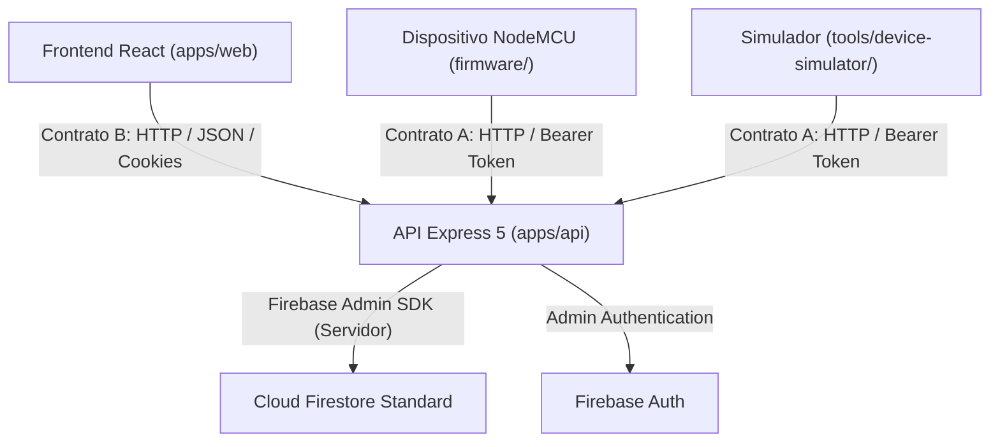

# PulsoLink — Arquitectura del Sistema

Documentación de arquitectura, diagramas de flujo y decisiones de diseño técnico.

---

## 1. Diagrama de Flujo del Sistema

---

## 2. Decisión de Persistencia y Seguridad

- **Acceso Exclusivo de Servidor:** La base de datos Cloud Firestore y Firebase Auth se consumen exclusivamente desde `apps/api`. No hay SDKs clientes en el frontend ni en los microcontroladores.
- **Idempotencia:** La ingestión del Contrato A utiliza la clave `deviceId + bootId + sequence` para prevenir registros duplicados y gestionar reintentos transparentemente.
- **Auditoría de Roles:** Validación de roles `admin` y `operator` efectuada en los middlewares de la API de Express.
