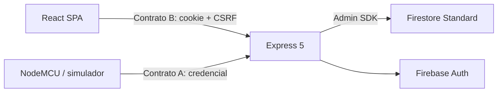

# Arquitectura de PulsoLink

La especificación normativa es el [contrato aprobado del 18 de octubre](contrato-aprobado-2026-10-18.md). El [plan vigente](../planificacion/ejecucion-2026-10-18.md) distingue implementación actual, cambios y evidencia pendiente.

Paciente → asignaciones históricas → sesiones → mediciones. Una placa y un paciente admiten a lo sumo una asignación activa cada uno. Toda lectura conserva `patientId`, `deviceId`, `assignmentId` y `sessionId` fijados por el servidor. La reasignación nunca modifica lecturas anteriores.

El [modelo objetivo](../../firebase/modelo-objetivo.md) conserva subcolecciones y deduplicación. El acceso a datos es exclusivo del backend. La API objetivo valida roles `admin|viewer`, recursos habilitados, pertenencia y estados; Admin SDK ignora Security Rules. El código todavía usa `operator` y sesiones con `participantCode`.

Los [OpenAPI A](../../contracts/device.openapi.yaml) y [B](../../contracts/web.openapi.yaml) versión 2.0.0 son el contrato objetivo, pendiente de implementación coordinada. No se crea otro servidor ni otra ruta de ingestión. No hay almacenamiento offline en el emisor. La conexión de una placa no demuestra contacto ni calidad clínica.
