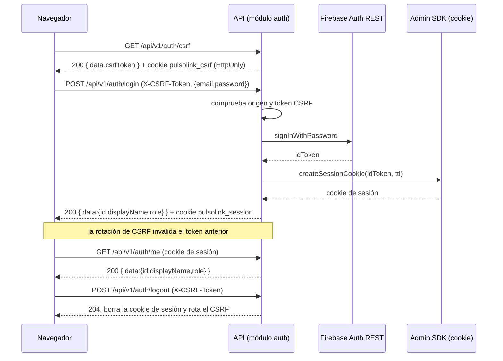

> **Migración pendiente:** la implementación descrita aquí conserva `admin|operator`. El contrato objetivo usa `admin|viewer`; `viewer` solo consulta y toda administración requiere `admin`. Ver [plan de migración](planificacion/ejecucion-2026-10-18.md). La auditoría de login y apertura de expediente aún debe implementarse.

# Módulo de autenticación y autorización (contrato B)

Documento del bloque de Autenticación y autorización (`@Mar-03`). Implementa la
sección 9 del `README.md` como el módulo `apps/api/src/modules/auth`, ya
**integrado en el esqueleto de Express** (`apps/api/src/app.ts`) y probado con la
aplicación real (`apps/api/test/auth`). No requiere un proyecto real de Firebase
para las pruebas (adaptadores en memoria).

- No usa Google Sign-In.
- No usa el SDK cliente de Firebase en el navegador.
- Las credenciales se verifican con Firebase Auth REST; la cookie de sesión se
  crea y verifica con el Admin SDK.
- Los roles se leen de Firestore, nunca del formulario de login.

## Flujo de acceso



## Endpoints

| Método y ruta | Autenticación | Respuesta |
| --- | --- | --- |
| `GET /api/v1/auth/csrf` | ninguna | 200 `{ data: { csrfToken } }` |
| `POST /api/v1/auth/login` | CSRF + origen | 200 `{ data: { id, displayName, role } }` + cookie de sesión |
| `POST /api/v1/auth/logout` | CSRF + origen | 204 sin cuerpo; borra la cookie de sesión |
| `GET /api/v1/auth/me` | cookie de sesión | 200 `{ data: { id, displayName, role } }` |

El login nunca devuelve `idToken`, cookie, `uid` de Firebase ni la contraseña.

## Códigos de error

| HTTP | Código | Cuándo |
| --- | --- | --- |
| 400 | `VALIDATION_ERROR` | Cuerpo de login inválido (incluye campos extra como `role`) o JSON malformado |
| 401 | `INVALID_CREDENTIALS` | Correo inexistente, contraseña incorrecta o usuario deshabilitado en Firebase Auth |
| 401 | `UNAUTHENTICATED` | Sin cookie, cookie inválida/vencida/revocada o usuario sin documento `users/{uid}` |
| 403 | `USER_DISABLED` | `users/{uid}.enabled === false` |
| 403 | `FORBIDDEN` | Rol insuficiente |
| 403 | `CSRF_INVALID` | Token CSRF ausente/inválido u origen no permitido |
| 413 | `PAYLOAD_TOO_LARGE` | Cuerpo de la petición mayor a 8 KiB |
| 429 | `TOO_MANY_ATTEMPTS` | Límite de intentos o Firebase `TOO_MANY_ATTEMPTS_TRY_LATER` |
| 503 | `AUTH_UNAVAILABLE` | Firebase no responde o devuelve 5xx |

Formato:

```json
{ "error": { "code": "UNAUTHENTICATED", "message": "No hay una sesión activa.", "requestId": "..." } }
```

## Cómo está integrado

El módulo vive en `apps/api/src/modules/auth`. Su punto de entrada
(`modules/auth/index.js`) exporta los middlewares ya ligados a los adaptadores
reales; `modules/auth/deps.js` construye la configuración desde el entorno y los
adaptadores de Firebase/ Firestore una sola vez.

```ts
// apps/api/src/app.ts (ya aplicado)
import { authRouter } from './modules/auth/auth.routes.js';
import { requireUser, csrfProtection } from './modules/auth/index.js';

app.use('/api/v1/auth', authRouter);
app.use('/api/v1/devices', requireUser, devicesRouter);
app.use('/api/v1/sessions', requireUser, csrfProtection, sessionsRouter);
```

- `authRouter` se construye con `createAuthRouter({ config, identityProvider, userRepository })`
  (ver `auth.routes.ts`). No vuelve a montar `cookie-parser` ni `express.json`:
  la aplicación ya los aplica (`app.ts`) y el manejador global
  (`middleware/error-handler.ts`) traduce `AuthError`, el JSON malformado
  (`entity.parse.failed` → 400 `VALIDATION_ERROR`) y el cuerpo demasiado grande
  (`entity.too.large` → 413 `PAYLOAD_TOO_LARGE`).
- `requireUser` deja `req.user` con `{ id, displayName, role }` (sin `enabled`).
  Lee la cookie de sesión aunque la aplicación no monte `cookie-parser`.
- `requireRole(...roles)` devuelve 401 si no hay usuario y 403 `FORBIDDEN` si el
  rol no coincide.
- `csrfProtection` se antepone a las mutaciones web y deja pasar `GET/HEAD/OPTIONS`.
  En `/api/v1/sessions` va **después** de `requireUser`, por lo que una petición
  sin sesión responde 401 `UNAUTHENTICATED` (no 403 `CSRF_INVALID`).
- `canAccessSession(user, session)` decide la propiedad de una sesión. El módulo
  **no** la aplica: el implementador de sesiones (Issue #5, `@Didhyer`) debe
  usarla y responder **404** (no 403) cuando sea ajena.

```ts
import { canAccessSession } from '../modules/auth/index.js';

if (!canAccessSession(req.user!, session)) {
  // El README (sección 7) exige 404, no 403, para no revelar recursos ajenos.
  return res.status(404).json({ error: { code: 'NOT_FOUND', message: 'Recurso inexistente.', requestId } });
}
```

El límite de intentos de login es propio (`modules/auth/login-rate-limit.ts`); el
monorepositorio **no** incluye `express-rate-limit`.

## Variables de entorno

Presentes en `apps/api/.env.example` (nunca valores reales en Git):

```text
FIREBASE_WEB_API_KEY=<tu-api-key>          # opcional al arrancar
FIREBASE_PROJECT_ID=<tu-project-id>
CORS_ORIGIN=http://localhost:5173           # reemplaza a APP_ORIGINS; admite lista separada por comas
CSRF_SECRET=<secreto-de-32-caracteres-o-mas>
COOKIE_SECURE=true
SESSION_TTL_HOURS=8
LOGIN_RATE_LIMIT_MAX=10
LOGIN_RATE_LIMIT_WINDOW_MS=900000
# Opcional, solo desarrollo:
FIREBASE_AUTH_EMULATOR_HOST=127.0.0.1:9099
```

- `CORS_ORIGIN` define los orígenes permitidos por CORS y por la validación de
  `Origin/Referer` del CSRF. Cada entrada se normaliza a su origen canónico.
- `FIREBASE_WEB_API_KEY` es **opcional en el arranque**: sin ella la API inicia
  igualmente (health checks) y `POST /api/v1/auth/login` responde 503
  `AUTH_UNAVAILABLE`.
- En `NODE_ENV=production`, usar el valor de desarrollo de `CSRF_SECRET` o un
  secreto de menos de 32 caracteres es un error de configuración.

Si falta o es inválida una variable, `loadAuthConfigFromEnv()` lanza un error
que nombra la variable, nunca su valor.

`COOKIE_SECURE` está **activo por defecto**: si la variable no se define, las
cookies llevan `Secure` y solo se transportan por HTTPS. Solo pasa a `false`
cuando se declara exactamente `COOKIE_SECURE=false`, y esa excepción se limita
al **desarrollo local por HTTP**. En cualquier otro entorno debe permanecer en
`true`.

## Modelo `users/{uid}`

Gestionado por persistencia (`@gioore`) en
`apps/api/src/modules/users/users.repository.ts`:

```json
{
  "displayName": "Ada Lovelace",
  "role": "admin",
  "enabled": true,
  "createdAt": "Timestamp"
}
```

El módulo de auth **no** accede a Firestore directamente: el adaptador
`modules/auth/adapters/users-repository-adapter.ts` envuelve `UsersRepository`,
mapea `uid` → `id` y valida el documento con Zod (`role ∈ {admin, operator}`,
`enabled` booleano). Si el documento no existe o no cumple el esquema, devuelve
`null` y registra un aviso solo con el `uid`.

## Aprovisionamiento de cuentas

Se realiza en **dos pasos**, en este orden (ambos idempotentes):

1. **Identidades de Firebase Authentication** (este módulo):

   ```powershell
   npx tsx src/scripts/provision-auth-users.ts
   ```

   Requiere `FIREBASE_PROJECT_ID`, `PROVISION_ADMIN_EMAIL`,
   `PROVISION_ADMIN_PASSWORD`, `PROVISION_ADMIN_NAME`,
   `PROVISION_OPERATOR_EMAIL`, `PROVISION_OPERATOR_PASSWORD` y
   `PROVISION_OPERATOR_NAME` (y, en desarrollo, ambos hosts de emulador o
   ninguno). **Solo** crea/actualiza identidades en Authentication: **nunca**
   escribe en Firestore. Imprime correo, uid, rol y si fue creado o actualizado,
   y al final una línea `DEMO_PROFILES_JSON=[{"uid":...,"displayName":...,"role":...}]`
   con los UID reales (sin contraseñas).

2. **Perfiles `users/{uid}` y dispositivo** (`@gioore`):

   ```powershell
   npx tsx src/scripts/provision-demo.ts
   ```

   Toma `DEMO_PROFILES_JSON` (salida del paso 1), `DEMO_DEVICE_ID`,
   `DEMO_CREDENTIAL_ID` y `DEMO_DEVICE_SECRET`; crea los documentos en Firestore
   y el dispositivo simulado. Requiere que las identidades del paso 1 ya existan.

Las contraseñas solo se envían a Firebase Authentication; nunca se guardan en
Firestore, ni en `.env`, ni en los registros de los scripts. Ante un error, los
scripts **no** imprimen el error del SDK.

## Decisiones

- **CSRF:** double-submit firmado con HMAC-SHA256 y ligado a la cookie del
  navegador; rotación del secreto tras login y logout, de modo que el token
  anterior deja de servir.
- **404 para sesiones ajenas:** si `canAccessSession` devuelve `false`, el
  endpoint de sesiones responde 404 (no 403), según la sección 7 del README.
- **Mismo 401 para correo inexistente o contraseña incorrecta:** mismo código y
  mismo mensaje para no revelar si la cuenta existe. Firebase `USER_DISABLED`
  también se agrupa en `INVALID_CREDENTIALS`.
- **Roles en Firestore:** el rol proviene de `users/{uid}`, nunca del formulario;
  un `role` en el cuerpo de login produce 400 por validación estricta.
- **`createSessionCookie` ante fallo:** un error del Admin SDK se traduce a 503
  `AUTH_UNAVAILABLE` para no exponer detalles.

## Frontend web (diferido)

La interfaz de autenticación (formulario de login, protección de rutas, menú de
usuario y cierre de sesión en la SPA) **no se implementa en este cambio**. Se
construirá sobre la **base web de `@AxelHerrera11`** (`feat/web-base`, aún no en
`main`), que modifica `router.tsx`, `Header.tsx` y `api-client.ts` e incorpora un
`ProtectedRoute.tsx` para autenticación. Coordinar entonces:

- `AuthCard` conectado a `POST /api/v1/auth/login` (obteniendo antes el token con
  `GET /api/v1/auth/csrf`) y `POST /api/v1/auth/logout`.
- `GET /api/v1/auth/me` como fuente del usuario para el encabezado y para la
  protección de rutas, integrándose con el `ProtectedRoute` de la base de Axel.
- Sin `localStorage`/`sessionStorage`: la sesión vive en la cookie `HttpOnly`.

Los endpoints de esta sección ya están listos y probados (contrato B,
`contracts/web.openapi.yaml`).

## Pendientes reales

- Implementar el frontend de auth sobre la base web de `@AxelHerrera11`
  (ver «Frontend web (diferido)»).
- Probar contra el emulador o un proyecto Firebase real; **aún no ejecutado**
  salvo que se indique lo contrario con evidencia. Las pruebas actuales usan
  adaptadores en memoria y la aplicación real con `FIREBASE_WEB_API_KEY` vacía.
- Que el implementador de sesiones (Issue #5) aplique `canAccessSession` y
  responda 404 (no 403) en recursos ajenos.
- Confirmar con `@gioore` el esquema definitivo de `users/{uid}` y las reglas de
  Firestore (acceso directo de clientes denegado).
