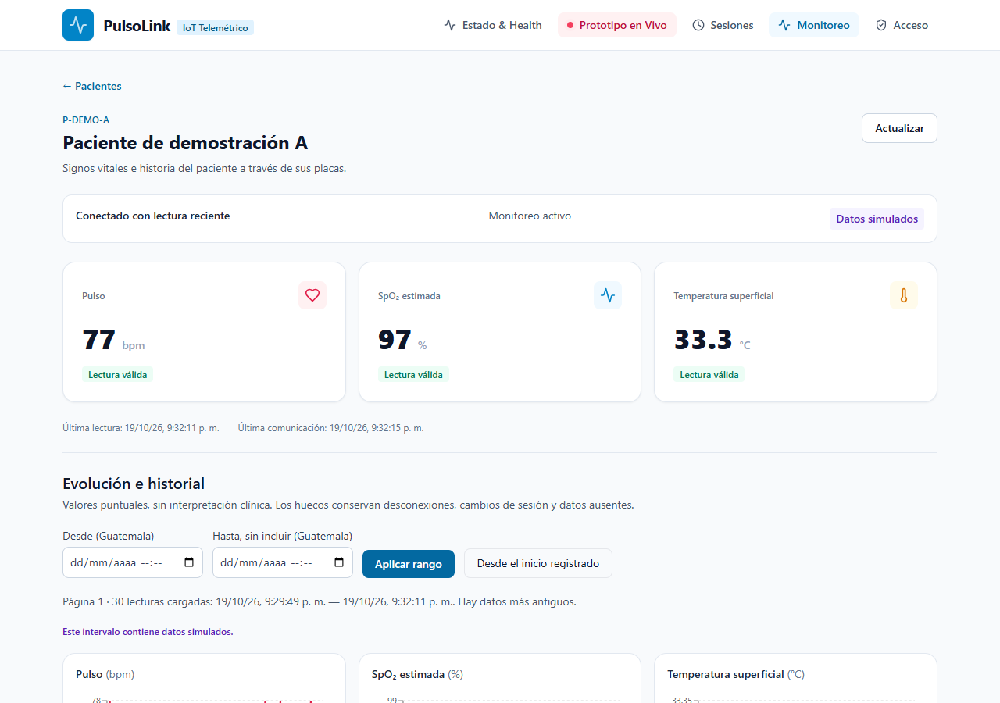
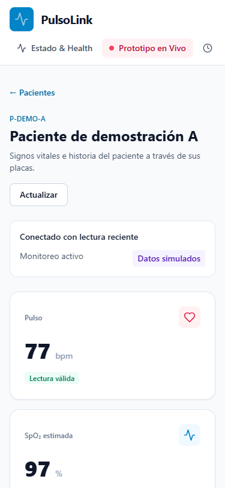

# Dashboard por paciente — propuesta de Gerson para #29

Estado: implementación revisable, **pendiente de validación de Keily, Marielos y Axel** antes de consolidar el diseño. La supervisión del backend corresponde a Sebastián. No se marca cerrado el issue compartido por tener capturas.

## Propuesta

- `/monitoring`: selección paginada de pacientes, sin CRUD administrativo.
- `/monitoring/:patientId`: identidad seudónima, conexión/estado de sesión, tres tarjetas con unidad y calidad, hora de muestra/comunicación, tres gráficas independientes y tabla histórica.
- Espaciado, tipografía y colores continúan el layout blanco/azul existente. Navegación móvil desplazable; tabla dentro de su propio contenedor, sin ensanchar la página.
- Temperatura superficial y SpO₂ estimada se identifican como académicas. Se muestra origen simulado cuando corresponde. Ningún umbral visual pretende diagnosticar.

## Integración y comportamiento

La pantalla usa TanStack Query y el cliente HTTP común con cookies/CSRF. Confirma `auth/me`, registra un `viewId` idempotente por apertura y solo después carga el expediente. Los fallos de acceso bloquean el contenido. API aplica la autorización; la protección visual no la sustituye.

Se consulta latest cada 2 s solo mientras la sesión es activa y la página visible; al salir/finalizar se detiene. La primera página histórica se refresca como máximo cada 10 s durante monitoreo activo. El resto de páginas no hace polling. Carga/error/vacío/permisos se muestran de forma explícita.

Filtros de fecha en hora de Guatemala (UTC−6), from inclusivo/to exclusivo. Se carga una página de hasta 100 muestras; se informa su intervalo exacto y si quedan datos más antiguos. Se puede navegar hasta el inicio registrado sin descargar todo cada 2 s. La gráfica solo representa la página indicada; el botón «Desde el inicio registrado» elimina filtros y permite navegar el intervalo completo por páginas, sin prometer que la primera página sea el expediente entero.

Las series se ordenan cronológicamente y deduplican por sesión + ID. Los valores inválidos permanecen null. Un intervalo >10 s, cambio de sesión, asignación o placa introduce un hueco; `connectNulls=false`. La tabla ofrece valores y calidad además de la gráfica. La carga de Recharts y de la página se hace mediante importación diferida.

Javier puede reutilizar los tipos, `trendPoints` y `listByPatient`; coordinar cualquier sustitución de hooks compartidos para evitar dos consultas históricas paralelas. Didhyer puede reutilizar las lecturas HTTP ya integradas. El formulario de login y los CRUD administrativos continúan bajo sus responsables.

## Evidencia visual de contrato

Estas capturas usan **respuestas HTTP simuladas en Playwright**, no una sesión clínica ni una demostración de nube. La integración real Auth/Firestore se verifica por separado en `patient-monitoring-api.test.ts`.





La revisión automatizada comprueba escritorio 1280×900, móvil 375×812 sin desbordamiento horizontal, navegación de páginas, un evento de apertura, polling independiente del historial, detención al salir y error de permisos. El fixture está en `tools/firebase/review-dashboard.cjs`. Con Playwright CLI instalado y Vite activo:

```powershell
New-Item -ItemType Directory -Force '.cache' | Out-Null
node -e "require('fs').writeFileSync('.cache/dashboard-review.js',require('./tools/firebase/review-dashboard.cjs').toString())"
playwright-cli -s=gerson-pl2 open about:blank
playwright-cli -s=gerson-pl2 run-code --filename=.cache/dashboard-review.js
playwright-cli -s=gerson-pl2 close
```

No se exportan cookies para esta revisión. Validar con los supervisores la jerarquía de tarjetas, navegación e historial y aportar revisión QA de #33 antes de declarar lista la pantalla.
