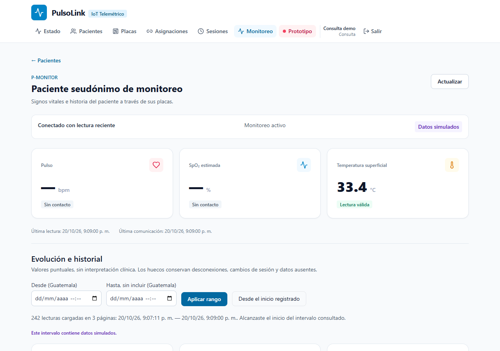
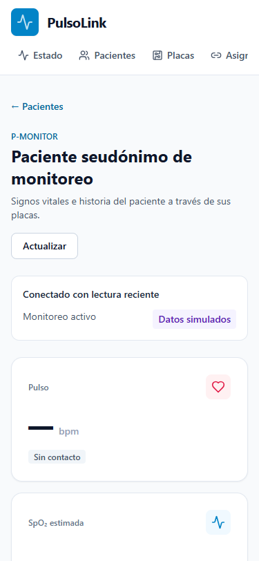

# Gerson — prueba local de Auth, persistencia y monitoreo

Fecha: 20 de octubre de 2026 (America/Guatemala). Relacionada con #25/#26/#29/#34. Son resultados ejecutados, con datos seudónimos y emuladores; no constituyen aprobación visual ni cierre de issues.

## Revisiones comprobadas

Se creó una rama **solo local**, `chore/gerson-prueba-integrada`, desde `563e09d` del PR #43, y se combinaron:

- #41, Auth: `d9180f5e45acab78f8ba18fd045ad766b5f77b65`.
- #42, datos de monitoreo: `e1a0387883499fcc6d5786bb95a5e465e83d2a2e`.
- HEAD de la combinación local: `2586960b33bb62203b0318164606f48584ca638b`.

Las dos combinaciones no tuvieron conflictos textuales. Esas fusiones **no se publican en #43 ni se aplicaron a main**. Los scripts y esta evidencia se presentan sobre la rama documental de Gerson; para ejecutar el recorrido se necesitan las implementaciones de ambos PR, cuya incorporación corresponde a sus revisores.

## Entorno y comandos ejecutados

Windows PowerShell, Node 24.15.0, Java 21, Firebase CLI 15.34.0, Chromium mediante Playwright/Chrome sin ventana visible. Firestore Emulator 1.22.0 inició en edición **Standard**, junto con Auth Emulator, proyecto desechable `demo-pulsolink`.

En la combinación local:

```powershell
npm ci --ignore-scripts
./tools/firebase/verify-gerson.ps1
npm run test --workspace=apps/web
```

Resultado: instalación desde lockfile, typecheck y build globales correctos; **148 pruebas API en 22 archivos** y **16 pruebas web aprobadas**. Las dos pruebas web contra API se omitieron inicialmente porque ese comando no tenía sesión. El recorrido de navegador las ejecutó después con una sesión real de emulador, en memoria: **2/2 aprobadas**. No se cuentan como aprobadas por haber sido omitidas.

El primer recorrido real pasó. Se amplió para comprobar estados de conexión e ingestión de muestras nuevas y se ejecutó mediante:

```powershell
# Ruta al paquete Playwright ya instalado en el entorno de herramientas.
# Ejemplo genérico; sustituir por la ruta real de esta computadora.
$env:PULSOLINK_PLAYWRIGHT_MODULE = 'C:/ruta/herramientas/node_modules/playwright'
./tools/firebase/verify-patient-integration.ps1 -SkipChecks
```

`-SkipChecks` se usó porque tipos, build, API y pruebas web ya acababan de pasar sobre la misma combinación de código. La ruta usada localmente apuntaba al runtime de herramientas de Codex. No se añade Playwright como dependencia de producción ni se modifica el lockfile en este PR.

## Qué comprueba el recorrido

El script [`verify-patient-browser.cjs`](../../tools/firebase/verify-patient-browser.cjs) inicia API/Vite propios en 13001/15173, rechaza puertos ocupados y requiere ambos emuladores locales y un proyecto `demo-`. Usa el formulario de login real de #41 y las consultas/hooks de #42. **No intercepta respuestas HTTP ni usa fixtures de red**. Las identidades y lecturas son datos sintéticos sembrados en los emuladores.

| Caso | Resultado observado |
| --- | --- |
| Aprovisionamiento y semilla repetidos | Primera ejecución crea perfiles/datos; segunda no sobrescribe ni vuelve a crear el historial. |
| Login viewer y retorno al expediente | Cookie HttpOnly emitida por la API; vuelve a `/monitoring/monitor-patient`. |
| Historial acumulado | 100 → 200 → 240 lecturas en tres páginas; ambas placas aparecen en la tabla, con calidad sin contacto. |
| Pruebas de datos contra API autenticada | Las dos pruebas de `monitoring-api.integration.test.ts` pasan con la sesión de emulador en memoria. |
| Auditoría | Un POST de apertura y un evento `patient.view`; el polling no añade aperturas. |
| Polling | Latest se actualiza; el archivo acumulado no se vuelve a descargar por el tick; al salir cesan las consultas de latest. |
| Tres estados de conexión | Desconectado con presencia antigua; conectado sin lectura reciente después de heartbeat; conectado con lectura reciente después de nueva muestra. |
| Ingestión persistida y duplicados | Dos muestras nuevas elevan 240 a 242; repetir idéntica la primera devuelve `duplicate:true` y no crea una tercera. |
| Calidad por magnitud | Ópticos `no_contact` quedan null; temperatura válida sigue disponible. La API conserva `connected_with_recent_reading` porque al menos una magnitud es válida. |
| Viewer | `GET /users` y `GET /audit-logs` responden 403. |
| Logout | Volver al expediente redirige al login y no muestra el contenido protegido. |
| Escritorio/móvil | Capturas 1280×900 y 375×812 revisadas; sin desbordamiento de página. |

Para las transiciones de presencia y muestras nuevas, el ayudante invoca los **repositorios reales** con los emuladores. No afirma haber ejercitado el firmware, la cabecera de dispositivo o el router objetivo de ingestión. Tampoco realiza una reasignación por los CRUD web: los dos tramos históricos vienen de la semilla de Javier. Las transacciones de cambio de placa y exclusividad se comprueban por separado en la suite API/persistencia.

Resumen emitido por el recorrido ampliado:

```json
{"patientBrowser":"passed","api":"real-local","emulators":"auth-firestore-standard","seedRepeated":true,"realApiHistoryTests":2,"pages":3,"historicalReadings":240,"newReadings":2,"boards":2,"accessEvents":1,"connectionStates":3,"identicalDuplicate":true,"opticalNullIndependentOfTemperature":true,"archiveNotPolled":true,"pollingStops":true,"viewer403":true,"logoutClearsView":true,"mobileOverflow":false}
```

Las contraseñas se generan en memoria. La sesión se transmite al proceso de pruebas en su entorno, sin escribir `.env`, cookies, tokens o storageState en archivos ni argumentos. Los errores del ayudante solo imprimen la etapa controlada; no vuelcan el DOM de login ni peticiones. Las capturas contienen únicamente datos seudónimos del dashboard.





## Reproducción por otro integrante

Requisitos: checkout acordado con las implementaciones de #41/#42, Node 24, Java 21, dependencias instaladas desde el lockfile, Playwright disponible y Chrome instalado. También se puede proporcionar un módulo Playwright del entorno de herramientas mediante `PULSOLINK_PLAYWRIGHT_MODULE`; el script reconoce el paquete en PATH de npm exec. `PULSOLINK_BROWSER_CHANNEL` permite elegir otro canal de navegador instalado.

Desde ese checkout, después de `npm ci`, ejecutar [`verify-patient-integration.ps1`](../../tools/firebase/verify-patient-integration.ps1). Sin `-SkipChecks` encadena tipos/build, API con emuladores, pruebas web y el recorrido; esta ejecución realizó esos pasos por separado, como se registra arriba. El wrapper rechaza la ausencia de implementaciones requeridas, no combina ramas ni descarga navegadores automáticamente. En main actual debe detenerse por las dependencias pendientes; no se debe confundir ese bloqueo con un fallo del código de Firebase.

Un primer reintento encontró el proceso Java que Firebase CLI había dejado de la ejecución anterior en Windows y rechazó el puerto ocupado. Se identificó y detuvo exclusivamente ese emulador de esta prueba. El wrapper posterior limpia solo un proceso Java iniciado durante su propia ejecución, con el proyecto demo y puerto esperados. El recorrido ampliado terminó con los cuatro puertos de verificación libres.

## Lo que todavía impide terminar

| Pendiente | Qué se necesita para continuar |
| --- | --- |
| Incorporación de #41/#42 | Revisiones del equipo y merge por quien corresponda. Esta prueba local no publica ni aprueba sus fusiones. |
| Aceptación #25 | Otro integrante debe reproducir los comandos y Didhyer/Marielos confirmar firmas/DTO. Esta ejecución propia no reemplaza esas confirmaciones. |
| Aceptación #26 | Presentar las pruebas y obtener el acuerdo de aceptación; no añadir una exigencia de nube que no figura en sus criterios. |
| Diseño y QA #29/#33 | Keily, Marielos, Axel y QA deben revisar interfaz y evidencias. Las capturas no equivalen a su aprobación. |
| Recorrido administrativo oficial | Falta #27: CRUD de negocio y corte de ingestión/sesiones al contrato 2.0.0. No se implementa el módulo ajeno en este PR. |
| Firebase de prueba real #34 | ID del proyecto aprobado, acceso autorizado y sesión local de Firebase. `firebase login:list --json` devolvió cero cuentas en esta revisión; no se crearon recursos ni se desplegaron índices. |
| Migración/deploy/hardware | Datos e inventario confirmados, respaldo y ventana cuando proceda; alojamiento/mismo origen/HTTPS con Sebastián, dependencias con Javier y NodeMCU en #35. |

La instalación/auditoría reportó 20 vulnerabilidades de dependencias (13 moderadas, 5 altas, 2 críticas); los paquetes con severidad alta/crítica reportados pertenecen al tooling, incluyendo Tailwind/Vitest y transitivas. Una comprobación `npm audit --omit=dev --json` al volver a la rama #43 reportó 10 moderadas, ninguna alta/crítica. Son resultados por entorno/lockfile, no una evaluación de explotabilidad. Varias correcciones propuestas implican versiones mayores: queda pendiente su tratamiento con Javier y supervisión, sin aplicar `audit fix --force` sobre los PR abiertos. Se conserva la advertencia del bundle principal (~824 kB); las advertencias de gráficos de dimensión cero de los tests JSDOM no aparecieron como fallo del navegador real.

No se cerraron issues ni se modificaron contratos, permisos de nube, credenciales o datos reales.
