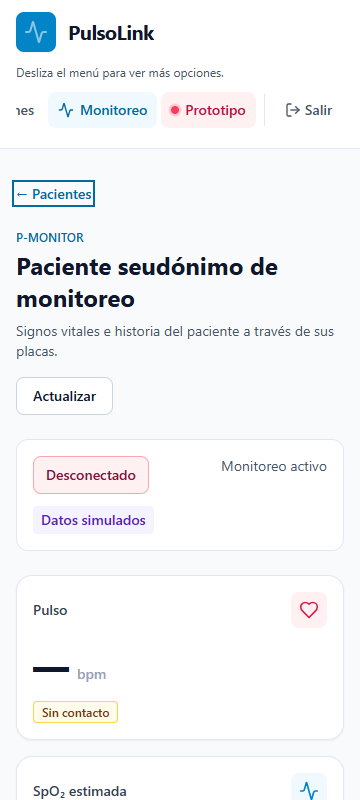
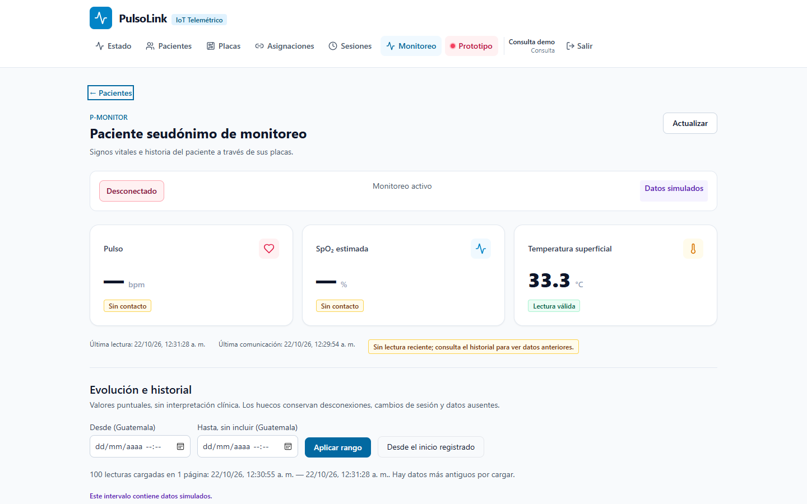

# PL2-09: aceptación integrada de interfaz

Entrega de apoyo a #33, con cambios separados para #30 (administración) y #29 (dashboard). Base original `a1c12bc`; las comprobaciones incluyen los tres cambios locales. Entorno: Windows, Node 24.22.1, Firebase CLI 15.34.0, Edge y Auth/Firestore Standard emulados; pacientes ficticios. No se usó nube ni placa física.

## Procedimiento

Desde PowerShell, con Node 24 en PATH y Playwright instalado:

```powershell
npm ci --ignore-scripts
npm run typecheck
npm run build
npm test --workspace=apps/web -- --maxWorkers=1
$env:PULSOLINK_BROWSER_CHANNEL = 'msedge'
$env:PULSOLINK_NATIVE_VISIBILITY = 'true'
$env:PULSOLINK_FULL_UI_ACCEPTANCE = 'true'
./tools/firebase/verify-patient-integration.ps1 -SkipChecks
```

`-SkipChecks` omite solamente las suites previas: no omite las aserciones de navegador. El wrapper exige puertos libres 18080/19099 y 13001/15173, crea un entorno desechable y detiene sus procesos. `PULSOLINK_PLAYWRIGHT_MODULE` admite la ruta a un módulo instalado; `PULSOLINK_FIREBASE_CLI` admite la ruta al ejecutable JavaScript de una instalación funcional de Firebase CLI. No se guardan cookies ni contraseñas.

Para repetir solo los casos administrativos y visuales, usar `PULSOLINK_UI_ACCEPTANCE_ONLY=true`, sin la bandera de visibilidad nativa. Este modo no ejecuta ni acredita los casos largos de historial; mantiene las dos integraciones HTTP autenticadas. Los resultados del recorrido largo se registran por separado.

## Cobertura y resultados

- Build global y tipos: aprobados con Node 24. El aviso de tamaño del bundle existe; lint no se acredita porque los scripts son marcadores.
- Suite web final, sin navegador concurrente: **39 aprobadas y dos omitidas por requerir sesión/API**, diez archivos (nueve ejecutados). Las dos integraciones HTTP se ejecutan desde el verificador con cookie efímera real y deben terminar con código 0.
- Historial: fase ejecutada con respuestas reales de Express y emuladores. Dos incrementos de 21 conservan 284 lecturas; 1120 lecturas inspeccionadas con máximo 1000 simultáneas y regreso a recientes. La ejecución completa de esa corrida se detuvo después en accesibilidad; no se presenta como un PASS global.
- Visibilidad nativa: fase aprobada, 47 muestras mientras la pestaña estaba oculta, 331 filas al volver, cero peticiones de polling oculta. No se sobrescribió visibilityState ni se fabricaron eventos.
- La suite administrativa crea opciones por HTTP, utiliza los formularios reales, verifica Tab/Escape/retorno, sesiones y dos placas con lecturas por ingestión oficial. Compara íntegramente la lectura original después de reasignar.
- Las pruebas de recuperación abortan peticiones reales; no se fabrican respuestas ni datos de medición.
- Ejecución final de aceptación administrativa/visual: **salida 0, 17 casos aprobados**, incluidas las dos integraciones HTTP autenticadas previas. Reporte: [results.json](marielos-pl2-09/results.json).

## Relación con criterios de aceptación

| Issue | Criterios cubiertos | Evidencia |
| --- | --- | --- |
| #30 | Formularios y bloqueo de envío; paginación y reintento | `admin-completion.test.tsx`, casos `patient-create-monitoring-link`, `device-forms-create`, `options-after-100-assignment` |
| #30 | Sesión, reasignación y conservación histórica | `session-create-start-finish`, `official-two-device-history-immutable-and-visible`, comparación profunda de la lectura original |
| #30 | Deshabilitación y conflictos; usuarios/auditoría; navegación | `disable-conflict-history-retained`, `admin-users-audit`, permisos viewer por HTTP y enlaces por rol |
| #29 | Tres estados, calidad independiente, nulos y avisos | Suite de tarjetas, fase de estados del verificador, capturas de dashboard real |
| #29 | Historial continuo y cobertura del intervalo | Fases de 284/331/1120 lecturas y navegación acotada, más pruebas de hooks/series |
| #29 | Móvil y accesibilidad | Capturas 360/768/1440; foco nativo, teclado, tabla desplazable y movimiento reducido calculado |
| #33 | Casos, entorno y pasos reproducibles | Reporte JSON y procedimiento anterior, con omisiones y fallos previos explícitos |
| #33 | Dos placas, cobertura, recuperación y permisos | Ingestión oficial de dos placas, historia inmutable, petición abortada/reintentada y viewer 403 |

La aprobación conjunta del diseño y la revisión de evidencias siguen siendo actos de revisión del equipo, no resultados inferidos de una suite automática.

Capturas reales del dashboard (360×800, 768×1024 y 1440×900) y resultados legibles por herramientas se adjuntan en `marielos-pl2-09/`. Las capturas usan el paciente seudónimo sembrado; no contienen datos reales.





## Defectos encontrados durante aceptación

Se completó el ciclo explícito de Tab del diálogo después de observar que el navegador podía abandonar el último control. Se añadió regresión para bloquear reasignación cuando falla la consulta y para reintentar el cursor del selector que falló. Se corrigió también el verificador para crear su directorio temporal en un checkout limpio y para medir navegación histórica por identidad de lectura, no por textos que pueden repetirse.

Los primeros intentos incluyeron una instalación incompleta del CLI, esperas de arranque en frío y fallos del ejecutor; se conservaron como diagnóstico y no se contaron como aceptación. En una suite concurrente con navegador hubo un timeout de componente; el resultado final se comprueba sin competir con ese recorrido.

## Cierre

El reporte y capturas adjuntos relacionan cada caso ejecutado. Las aprobaciones de diseño de Axel/coordinación, la revisión de QA y la decisión de cierre permanecen con sus responsables. Esta entrega no declara resueltos #34/#35/#51 ni acredita un despliegue o validación clínica. La desconexión del simulador sin cola conserva la evidencia previa de Hugo en #50; no se afirma haber repetido aquí ese ensayo físico o de corte de sockets.
