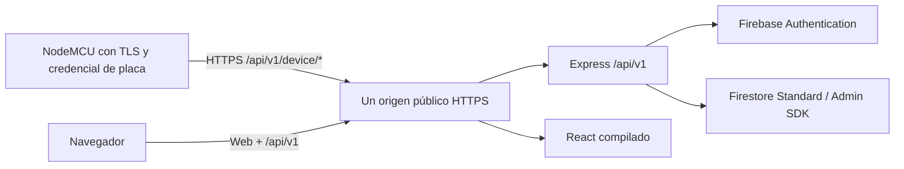

# Hosting y pruebas externas de PulsoLink

**Revisión:** 22 de octubre de 2026, aproximadamente 08:24, Guatemala (UTC−06:00).

**Base inspeccionada:** `main bb5c72d2319b9b78d10bfcff68c0e05819c1e636`, contrastada con GitHub.

**Alcance de esta entrega:** estado actual, alternativas de alojamiento y plantillas de variables. No se desplegaron servicios, habilitó facturación ni abrió un túnel público.

**Actualización de alojamiento:** el entrypoint de producción ahora sirve el build React junto con la API. Para desplegar ambos en el servicio existente, usar la [guía específica de Render](render.md) y `npm run build:deploy`; el inventario de GitHub de la sección 2 conserva el corte de esta revisión.

## 1. Recomendación para el equipo

**Para dejar la demostración disponible sin depender de una computadora: Render Starter, con web y API bajo un mismo origen HTTPS.** La referencia oficial consultada sitúa esa instancia en **USD 7/mes**; transferencia, servicios adicionales e impuestos deben revisarse aparte. Esta es una recomendación de simplicidad y previsibilidad para el prototipo, no un benchmark medido. [Referencia de precio del propio proveedor](https://render.com/articles/render-vs-railway).

**Para una prueba externa puntual antes de contratar hosting: Cloudflare Quick Tunnel hacia una API de pruebas.** Permite comprobar DNS, TLS y peticiones por Internet conservando el backend local conectado a Firebase. La computadora y el túnel deben permanecer encendidos. El firmware todavía necesita HTTPS y el protocolo oficial.

**Railway Hobby** es otra buena opción para ponerlo disponible pronto; su mínimo es **USD 5/mes con USD 5 de uso incluidos**, y cobra el excedente. **Cloud Run** es la opción más integrada con la identidad de Google/Firebase, pero exige preparar despliegue e identidad de servicio y habilitar facturación. [Railway: precios](https://railway.com/pricing), [Cloud Run: integración y facturación](https://firebase.google.com/docs/hosting/cloud-run).

## 2. Estado actual: qué cambió desde la auditoría de las 00:03

Al consultar GitHub había **7 issues abiertos y 1 PR abierto (#60)**. La auditoría anterior conserva su corte histórico; no describe por sí sola los merges posteriores.

| Entrega | Estado actual | Límite relevante |
| --- | --- | --- |
| Firebase y login | Implementados; conexión local a Firebase real disponible. | Tener Firebase no publica Express ni React en Internet. |
| Selectores y diálogos administrativos | [#58](https://github.com/codsebas/PulsoLink/pull/58), integrado. | La observación de selectores/diálogos de la auditoría tiene una entrega posterior; no se reabre aquí sin reproducir una regresión. |
| Estados y accesibilidad del dashboard | [#59](https://github.com/codsebas/PulsoLink/pull/59), integrado. | Evidencia y revisión de ese PR, no una nueva prueba visual realizada en esta entrega. |
| QA de permisos/API | [#57](https://github.com/codsebas/PulsoLink/pull/57), integrado. | #32 sigue abierto para aceptación del alcance restante. |
| QA de interfaz | [#61](https://github.com/codsebas/PulsoLink/pull/61), integrado; #33 cerrado. | No equivale a probar sensores físicos ni hosting público. |
| Aprovisionamiento de placa real | [#62](https://github.com/codsebas/PulsoLink/pull/62), integrado. | Falta ejecutarlo para la NodeMCU identificada y cargar su credencial; no asumir que ya existe esa credencial cloud. |
| Aprovisionamiento de usuarios y negocio cloud | [#63](https://github.com/codsebas/PulsoLink/pull/63), integrado. | Evidencia registrada de 95 comprobaciones cloud y limpieza; API local. No repetida aquí. |
| Descubrimiento de sesión externa | [#64](https://github.com/codsebas/PulsoLink/pull/64), integrado. | Ya hay corrección posterior a la hipótesis de la auditoría. |
| Concurrencia a cinco segundos | [#65](https://github.com/codsebas/PulsoLink/pull/65), integrado; #51 cerrado. | No se conserva como bloqueo abierto de hosting. La latencia del proveedor elegido requiere medición propia. |
| Contratos y errores | [#66](https://github.com/codsebas/PulsoLink/pull/66), integrado; #27 cerrado. | No se repiten como pendientes las diferencias corregidas. |
| Historial y Node24/scripts | [#60](https://github.com/codsebas/PulsoLink/pull/60), **abierto**. | Su política de conservar todo lo navegado y sus cambios de runtime/scripts todavía no están en main. |
| Firmware | Sketch con HTTP y endpoint de desarrollo. | No implementa todavía HTTPS ni el recorrido oficial completo. |
| Hosting | Sin configuración completa de despliegue localizada en el checkout. | Falta publicar web/API, mismo origen, secretos del hosting y validar desde fuera de LAN. |

Los issues abiertos son: [#25](https://github.com/codsebas/PulsoLink/issues/25), [#26](https://github.com/codsebas/PulsoLink/issues/26), [#28](https://github.com/codsebas/PulsoLink/issues/28), [#31](https://github.com/codsebas/PulsoLink/issues/31), [#32](https://github.com/codsebas/PulsoLink/issues/32), [#34](https://github.com/codsebas/PulsoLink/issues/34) y [#35](https://github.com/codsebas/PulsoLink/issues/35). Sus criterios/evidencias deben conciliarse con las entregas, sin interpretar “abierto” como “no implementado”.

## 3. Comparación de alternativas

Precios en USD consultados el 22/10/2026. Son referencias de planes/consumo, no cotizaciones de una carga medida de PulsoLink.

| Alternativa | Coste de referencia | Ventaja para PulsoLink | Condición / desventaja | Uso recomendado |
| --- | --- | --- | --- | --- |
| **Render Starter** | Instancia desde **7/mes**; revisar extras. | Proceso Express permanente y despliegue desde GitHub; coste de instancia fácil de prever. | Preparar estáticos/proxy del mismo origen y credenciales Firebase en el proveedor. | **Primera opción para la demostración alojada.** |
| **Railway Hobby** | Mínimo **5/mes**, incluye 5 de recursos; excedente por uso. | Soporta monorepos y dominios HTTPS; flexible para Express/contenedores. | Medir consumo, fijar límites y no habilitar suspensión para la prueba de latencia. No es una tarifa plana ilimitada. | Alternativa rápida y flexible. |
| **Cloud Run** | Por consumo, con tramo gratuito sujeto a condiciones. | Identidad de servicio/ADC; región compatible con Firestore; no necesita repartir JSON al contenedor. | Requiere facturación, build/despliegue y evaluar arranque en frío; una instancia mínima puede generar coste. | Mejor integración con Google a medio plazo. |
| **Render Free** | Compute gratuito sujeto a cuotas. | Útil para publicar un ensayo sin pagar instancia. | Se suspende tras 15 minutos sin tráfico y el arranque puede tardar alrededor de un minuto. Incompatible con prometer respuesta de 5 segundos desde frío. | Ensayo, con limitaciones visibles. |
| **Cloudflare Quick Tunnel** | URL temporal de prueba; sin contratar una instancia de aplicación. | Expone por HTTPS una API que ya funciona localmente, sin abrir puertos del router. | URL cambia, depende de la computadora, sin garantía de disponibilidad; límite de 200 peticiones simultáneas. | **Comprobación externa temporal.** |

Fuentes por alternativa: [Render Express](https://render.com/docs/deploy-node-express-app), [Render Free](https://render.com/docs/free), [Railway monorepos](https://docs.railway.com/deployments/monorepo), [Railway HTTPS](https://docs.railway.com/networking/public-networking), [Railway suspensión opcional](https://docs.railway.com/deployments/serverless), [Cloud Run precios](https://cloud.google.com/run/pricing), [Cloudflare Quick Tunnels](https://developers.cloudflare.com/tunnel/get-started/quick-tunnels/).

No hace falta contratar PostgreSQL, Redis ni otra base para reemplazar Firebase. La persistencia continúa en Firestore Standard y la identidad en Firebase Authentication.

### Arquitectura preferida



El origen puede ser la URL asignada por el proveedor; un dominio comprado no es requisito para empezar. DNS/TLS y la cadena de certificados elegida deben probarse en el ESP8266 real.

**Alojamiento implementado:** el entrypoint de producción proporciona `apps/web/dist` a Express, que sirve los estáticos y el fallback SPA después de los routers API. La [guía de Render](render.md) indica los comandos actuales. Las opciones arquitectónicas son:

1. Servir el build React desde Express con fallback SPA, preservando los 404 JSON de `/api/v1`.
2. Servir React con un proxy del mismo origen que reenvíe `/api/v1` a Express.

Ni `VITE_API_PROXY_TARGET` ni `VITE_API_BASE_URL=/api/v1` crean ese proxy en producción. El proxy de Vite existe únicamente durante desarrollo. Publicar el frontend estático sin resolverlo deja las peticiones a la API sin destino.

### Precaución específica con Firebase Hosting + Cloud Run

Firebase Hosting elimina normalmente las cookies al reenviar a Functions/Cloud Run y solo permite pasar la cookie llamada `__session`. PulsoLink utiliza `pulsolink_session` y `pulsolink_csrf`; un rewrite directo a Cloud Run no es compatible con el esquema actual sin adaptación y regresión de auth/CSRF. [Documentación de cookies de Hosting](https://firebase.google.com/docs/hosting/manage-cache).

Por eso, si se elige Cloud Run, la recomendación inicial es **servir web y API en el mismo servicio/origen**, sin poner el CDN de Firebase Hosting delante de esas rutas autenticadas. Alternativamente se puede diseñar otro proxy, pero debe preservar todas las cookies.

Tampoco basta publicar React en un dominio y Express en otro y modificar CORS: la sesión `SameSite=Lax` y CSRF requieren una topología compatible. Mantener el mismo origen reduce esos cambios.

## 4. Qué necesita el NodeMCU antes de probar la ruta externa oficial

En el sketch revisado, `WiFiClient` y `kApiUrl` apuntan a HTTP y a `/api/v1/dev/reading-test`. Esa ruta devuelve `persisted:false` y se monta solo en development. En production debe responder 404.

**Cambiar únicamente la IP LAN por una URL HTTPS no funciona con ese cliente HTTP ni completa el protocolo.**

Pendientes de firmware/integración:

1. Aprovisionar la placa real con el [procedimiento ya integrado](placa-fisica-aprovisionamiento.md). El secreto de dispositivo es distinto del JSON administrativo Firebase.
2. Usar `BearSSL::WiFiClientSecure`, anclas de confianza o almacén de certificados y hora válida para comprobar vigencia. No aceptar `setInsecure()` como prueba satisfactoria de TLS.
3. Consultar `GET /api/v1/device/config` con `Authorization: Bearer <credentialId>.<secret>`.
4. Consultar configuración periódicamente y enviar heartbeat. Sin sesión activa no enviar mediciones.
5. Crear/asignar/iniciar sesión desde la administración y obtener el `activeSessionId` oficial.
6. Enviar `MeasurementInput` a `POST /api/v1/device/measurements`.
7. Mantener `bootId`, secuencia, calidades y descarte de muestras generadas sin red.
8. Medir duración real del handshake y de cada petición. Considerar reutilización de conexión/sesión TLS si es necesaria; no confundir adquisición de sensores con intervalo de envío.

La documentación del ESP8266 explica que TLS requiere recursos y que la verificación de certificados con anclas de confianza utiliza hora obtenida por SNTP o fijada explícitamente. Esto debe probarse con el certificado del host elegido. [BearSSL en ESP8266](https://arduino-esp8266.readthedocs.io/en/latest/esp8266wifi/bearssl-client-secure-class.html).

No se modificó ni compiló el firmware en esta entrega. Corresponde a @codsebas, con apoyo del responsable API y Firebase.

## 5. Opción temporal: probar Internet con un túnel

Una vez instalada la herramienta `cloudflared` y preparada una **instancia de API destinada a pruebas**, el comando es:

```powershell
cloudflared tunnel --url http://localhost:3001
```

Cloudflare muestra una URL temporal `https://...trycloudflare.com`. La API continúa ejecutándose en tu computadora y continúa accediendo a Firebase cloud. El proceso no se ejecutó en esta entrega. [Funcionamiento y límites](https://developers.cloudflare.com/tunnel/get-started/quick-tunnels/).

Antes de abrirlo:

- Usar la configuración de producción/pruebas externas de la API, con secreto CSRF propio, y verificar que la ruta de desarrollo no está montada.
- Tener credencial de placa/simulador y datos ficticios preparados.
- Si también se accede a la web públicamente, resolver su origen/proxy y cookies; este comando expone solo la API.
- No habilitar una pantalla intermedia de PIN/correo para `/device/*`: la placa necesita llamadas HTTP automáticas con su propia credencial.

Para la placa, la base sería `https://HOST_GENERADO/api/v1`; sus rutas oficiales son `/device/config`, `/device/heartbeat` y `/device/measurements`. La URL exacta solo se conoce al iniciar el túnel. La autenticación del dispositivo sigue en Express.

La prueba debe realizarse también desde otra conexión, por ejemplo un teléfono con datos móviles o la placa conectada a un hotspot. Evitar cualquier dependencia de la IP privada de la computadora.

## 6. Plantillas .env corregidas

Las variables necesarias están **activas/descomentadas**. Los campos vacíos representan valores privados o alternativas que deben completarse; no se inventaron credenciales ni se copiaron las de este equipo.

| Archivo | Uso | Qué completar / conservar |
| --- | --- | --- |
| [API local](../../apps/api/.env.example) | Copiar a `apps/api/.env` para API local + Firebase real. | Clave web y método de credenciales Admin. Revisar puerto/origen. Incluye auth, sesiones, límites y variables de aprovisionamiento manual. |
| [API HTTPS](../../apps/api/.env.production.example) | Referencia para el panel de variables del hosting. | Origen público, CSRF aleatorio y Firebase. Cookies seguras; emuladores vacíos. |
| [Web local](../../apps/web/.env.example) | Copiar a `apps/web/.env`. | Proxy local y prefijo relativo de API. |
| [Web de producción](../../apps/web/.env.production.example) | Variables del build Vite o plantilla de `.env.production` local. | Mantener `/api/v1` después de configurar el mismo origen. |
| [Simulador y QA](../../tools/device-simulator/.env.example) | Copiar a `tools/device-simulator/.env`. | Base LAN/HTTPS y credencial del simulador. QA desactivado para escrituras hasta autorización explícita del ejecutor. |

**Cambios concretos respecto de las plantillas anteriores:**

- Clave web, credenciales alternativas, TTL y límites de login dejaron de estar ocultos como asignaciones comentadas.
- El proyecto de referencia es el proyecto de pruebas actual del equipo.
- Se distinguen credencial de servidor y credencial de dispositivo.
- Hosts de emuladores están presentes y vacíos por defecto, para no desviar una prueba cloud a un emulador.
- El rol nuevo de aprovisionamiento es viewer; se conservan vacías las entradas de scripts manuales para impedir altas accidentales.
- Se incorporan las variables del aprovisionador de placa real, con `PROVISION_APPLY=false`.
- Simulador documenta su configuración completa y la parte de QA, con `QA_ALLOW_WRITES=false`.
- Se añaden ejemplos específicos para HTTPS y se ignoran archivos `.env.*` reales, conservando versionables las plantillas `.example`.

### Cómo configurar sin romper lo que ya funciona

En este equipo **ya existen .env funcionales**. Esta entrega no los reemplazó. Copiar ejemplos sobre ellos borraría valores privados válidos. Usar las plantillas para comparar claves y agregar únicamente lo faltante.

Para un equipo nuevo, desde la raíz:

```powershell
Copy-Item 'apps/api/.env.example' 'apps/api/.env'
Copy-Item 'apps/web/.env.example' 'apps/web/.env'
Copy-Item 'tools/device-simulator/.env.example' 'tools/device-simulator/.env'
```

Hacerlo solo cuando los archivos de destino todavía no existan. Completar en el editor, sin publicar sus valores.

Para API local:

- `FIREBASE_WEB_API_KEY` debe pertenecer al mismo proyecto; sin ella el login responde 503.
- Completar `GOOGLE_APPLICATION_CREDENTIALS` con la ruta absoluta del JSON privado, o usar la alternativa explícita admitida por el servidor.
- El ejemplo toma `http://localhost:5173`. Si tu Vite actual está en 5174, usar `CORS_ORIGIN=http://localhost:5174`.
- Para esta topología, usar un solo origen exacto. El cargador de auth admite una lista, pero el middleware CORS actual recibe una cadena; no asumir que una cadena separada por comas funciona en ambos.
- `COOKIE_SECURE=false` es para HTTP local; en HTTPS, true.
- Reiniciar Express tras cambiar su entorno. Reconstruir Vite si cambia una variable de producción.

Para hosting:

- Las variables se configuran en el proveedor; `NODE_ENV=production` **no hace que dotenv cargue `.env.production` automáticamente**. El backend usa `.env` en su directorio de trabajo o el entorno del proceso.
- Usar el puerto que inyecte el proveedor. El ejemplo 8080 es una referencia, no una razón para sobrescribir el puerto asignado.
- Render/Railway: montar un archivo privado con el mecanismo del proveedor o usar correo/clave privada en secretos de entorno. Una ruta `C:/Users/...` no existe en Linux.
- Cloud Run: preferir identidad de servicio y ADC, con roles mínimos de Firestore/Auth; no incluir el JSON en la imagen.
- No llenar las tres alternativas de credenciales a la vez. Mantener vacíos los campos no utilizados.
- Mantener vacíos ambos hosts de emuladores. Los scripts de seed con proyecto `demo-` son para entornos desechables.
- Generar el secreto CSRF en un gestor privado o mediante una herramienta local que lo escriba directamente en el destino privado; no pegarlo en PR, capturas ni registros.

`QA_SESSION_ID` es un override opcional no definido en la plantilla del simulador: así se descubre la sesión desde config. Definirlo como cadena vacía también anularía ese descubrimiento, porque el ejecutor usa `??`. Si se necesita forzarlo, proporcionar un ID válido. El ejecutor QA completo requiere fixtures específicos y presupone una misma contraseña de prueba para admin/viewer; no usarlo indiscriminadamente contra las cuentas compartidas.

## 7. Preparación del despliegue elegido

Estos pasos describen el trabajo siguiente; esta entrega no configura ni cobra servicios.

1. Resolver el PR #60 antes de usar su runtime/scripts como parte de la entrega. Mientras tanto, fijar **Node 24** explícitamente en el proveedor: el `engines` de main aún permite 22.
2. Usar el alojamiento web de Express y su fallback SPA, con tests del límite `/api/v1`, como indica la guía de Render.
3. Mantener raíz del monorepo para instalar con su lockfile. Evitar instalar solo una subcarpeta suponiendo que tiene un lock independiente.
4. Construir API y web; fijar el inicio del proceso y el puerto del proveedor.
5. Configurar variables y credenciales en el proveedor; permitir acceso público al transporte HTTP de la ruta de dispositivo, dejando la autenticación real a Express.
6. Comprobar comportamiento de proxy/IP del limitador de login. No establecer `trust proxy=true` indiscriminadamente.
7. Probar arranque en frío, login, operaciones administrativas y mediciones antes de presentar resultados de latencia.

Comandos de referencia, cada uno por separado:

```powershell
npm ci
npm run typecheck
npm run build:deploy
npm run start --workspace=apps/api
```

Con `NODE_ENV=production`, el último comando inicia API y web compilada en el mismo proceso. Requiere el build anterior; desarrollo mantiene el servidor Vite separado. No usar `npm run dev` ni `vite preview` como proceso final de alojamiento.

Para Cloud Run, el contenedor debe escuchar en el puerto inyectado y en una interfaz accesible, no solo loopback. La plataforma termina TLS y reenvía al contenedor. [Contrato de contenedor de Cloud Run](https://docs.cloud.google.com/run/docs/container-contract).

## 8. Validación externa: qué resultado demuestra cada paso

| Paso | Resultado esperado | Qué demuestra |
| --- | --- | --- |
| Abrir `https://HOST/api/v1/health` desde datos móviles | 200 y modo cloud. | DNS/TLS y API accesible; no acredita todavía escritura Firestore. |
| Config sin credencial | 401 de Express, no HTML/challenge del proveedor. | Ruta pública alcanza la autenticación de aplicación. |
| Config con credencial válida | 200 e identidad de placa correcta. | Credencial/aprovisionamiento y config por Internet. |
| Heartbeat oficial | 200 y presencia actualizada. | Comunicación de placa registrada. |
| Iniciar sesión de monitoreo por la web | Config devuelve el ID activo. | Relación administrativa disponible para el dispositivo. |
| Primera medición oficial | 201, referencia y hora de recepción. | Petición aceptada y persistida; verificar documento/lectura mediante API. |
| Repetir exactamente la misma petición | 200, `duplicate:true`, misma referencia. | Idempotencia, sin duplicación. |
| Cambiar contenido con misma clave | 409 `IDEMPOTENCY_CONFLICT`. | Protección ante conflicto. |
| Abrir monitor como admin y viewer | Lectura del paciente correcto; viewer sin administración. | Integración web y permisos. |
| Desconectar/reconectar Wi-Fi | Hueco temporal sin lote atrasado. | Descarte sin cola. |
| Finalizar sesión | Nueva muestra de la sesión cerrada rechazada. | Control de ciclo de vida. |
| Cambiar placa | Historia previa permanece y nuevas lecturas conservan sus cuatro IDs. | Integridad histórica. |

Conservar evidencia sin credenciales: fecha/hora, SHA de backend/firmware, host, conexión usada, estado HTTP, duración y referencia de medición. No registrar `Authorization`, contraseñas, cookies o el secreto de placa.

## 9. Consumo de Firebase durante las pruebas

A dos segundos, una placa genera **1,800 muestras/hora** y **43,200 muestras/día** si se mantiene activa. Esto es un cálculo del intervalo, no una prueba de carga.

Firestore incluye una cuota gratuita de **20,000 escrituras y 50,000 lecturas diarias** en las condiciones documentadas. Solo los documentos de muestra de un día continuo ya superan esas escrituras; la implementación además escribe la clave de ingestión, presencia y habitualmente el resumen de sesión. No asumir una escritura total por petición. [Cuotas y facturación Firestore](https://firebase.google.com/docs/firestore/pricing).

Para pruebas cortas, registrar duración y revisar consumo compartido. Para funcionamiento continuo, estimar lecturas, escrituras, almacenamiento y hosting antes de elegir plan. Cloud Run en el proyecto Firebase requiere enlazar facturación; esa vinculación convierte Spark en Blaze. Hay cuota gratuita de Cloud Run, pero no garantiza una factura cero para la aplicación completa. No se habilitó facturación en esta entrega.

## 10. Verificación de esta entrega

- Base local contrastada con `main` remoto y consulta actual de issues/PRs.
- Inventario de variables comparado con los cargadores reales de API, auth, Vite y simulador, y con los scripts de aprovisionamiento.
- Plantillas analizadas con dotenv; comprobación de sintaxis, variables, defaults y configuración de auth/simulador sin usar secretos reales.
- Hosts de emuladores vacíos en plantillas cloud; escritura de QA y aprovisionamiento físico desactivadas.
- Campos de producción que requieren valores privados se dejan vacíos y se comprueba que CSRF vacío no es una configuración de producción aceptada.
- Verificación de exclusión Git de `.env`/variantes reales y seguimiento permitido de `.example`.
- Resultado: cinco plantillas analizadas, cobertura de las 15 variables runtime de API/auth, carga de esquema auth local/HTTPS y simulador correctas, ocho comprobaciones de exclusión Git aprobadas y enlaces locales válidos. La plantilla de API local incluye además entradas para scripts manuales, 33 asignaciones activas en total.
- Primera ejecución de configuración: Node 22.13.1. Después se repitieron todas las comprobaciones con **Node 24.22.1**, usando `npx --yes --package=node@24 node --import tsx` y sin cambiar la instalación global. Resultado: **PASS** para las cinco plantillas, cobertura de las 15 variables runtime, auth local/HTTPS, rechazo de CSRF vacío en producción, simulador, ocho controles de exclusión Git y enlaces locales. Esta repetición valida configuración; no constituye una nueva suite funcional de Firebase, navegador o hardware.
- Sin cambios en `.env` reales, sin nuevas escrituras cloud, sin nueva prueba de navegador/sensores ni despliegue externo.

**Siguiente decisión del equipo:** elegir Render Starter, Railway o Cloud Run para la entrega alojada, o realizar primero el ensayo temporal con túnel. La elección permite preparar el manifiesto/proxy concreto y la validación pública, manteniendo Firebase existente.
